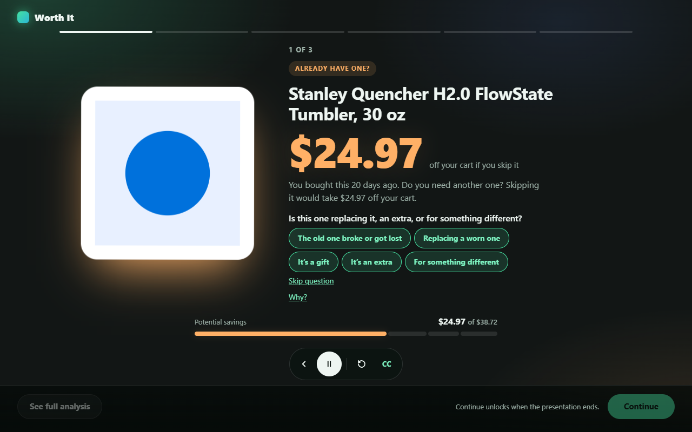
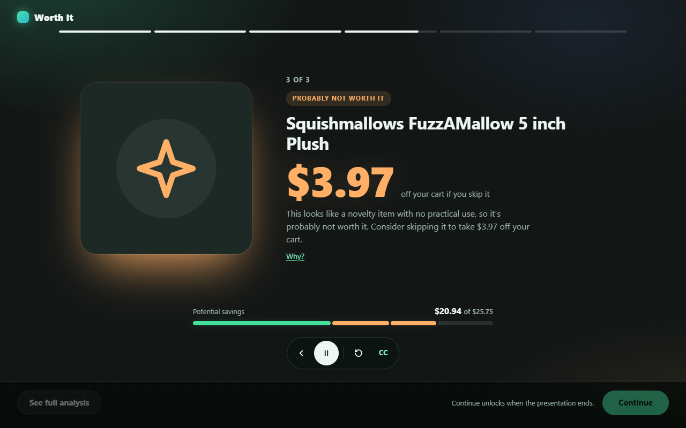
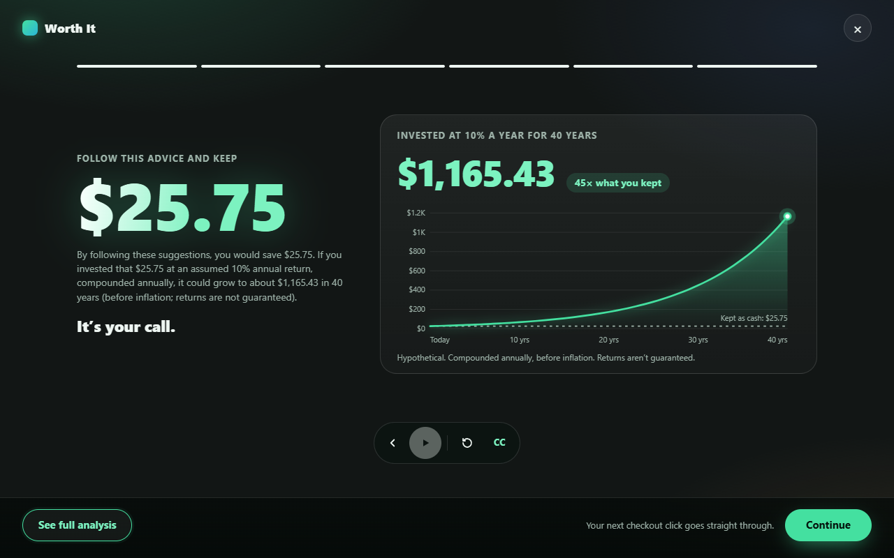
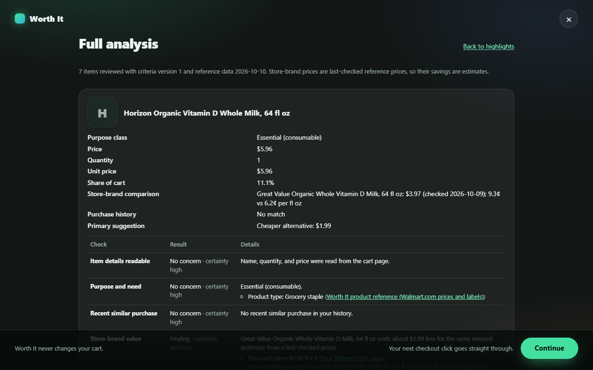
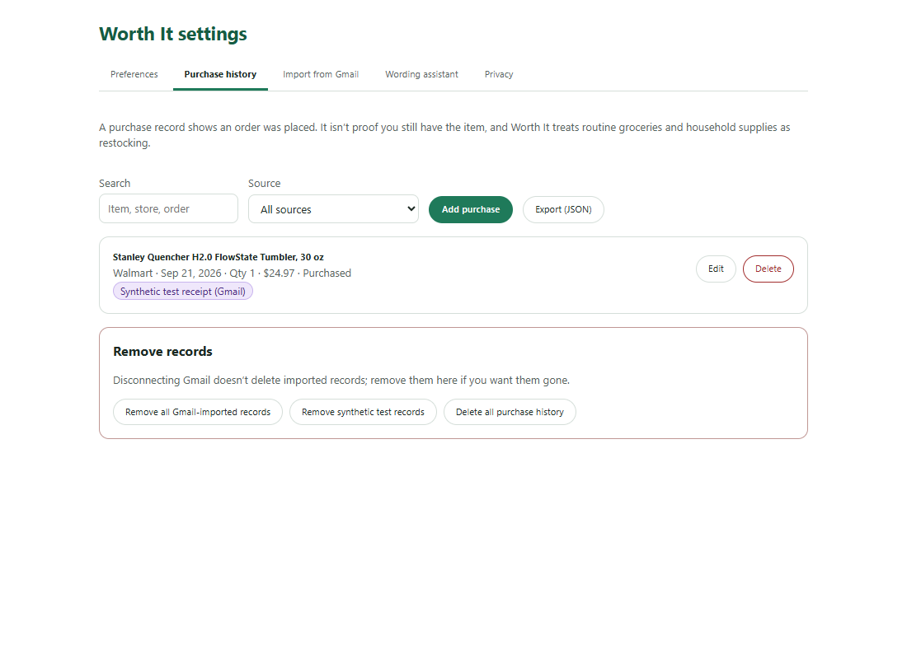

<div align="center">


# Worth It

**The last thing between your cart and your card: a moment to think twice.**

A Chrome extension that reviews your Walmart or Amazon cart at checkout and shows what's worth a second thought: a cheaper store brand, something you just bought, a novelty item you won't use, or a label-based health note. It then shows what you'd keep, and what that money could become.

Built for **Hacklanta 2026** · Fintech track

<br />



</div>

<br />

## How it works

1. **Shop as usual.** Nothing from Worth It appears on your cart page.
2. **Click Checkout.** If there's something worth a second look, your first click is held once and a short full-screen presentation plays.
3. **Decide.** Worth It highlights at most three items, shows what you'd keep, and then you continue. The next click goes straight through.

Worth It informs and suggests. It never edits your cart and never clicks anything for you.

<table>
  <tr>
    <td width="50%"></td>
    <td width="50%"></td>
  </tr>
  <tr>
    <td align="center"><sub>The product, the amount you'd save, and a few short reasons, for each highlighted item</sub></td>
    <td align="center"><sub>What you'd keep, and what it could grow to if invested</sub></td>
  </tr>
</table>

## What it looks for

| | |
|---|---|
| **Store-brand swap** | A cheaper store-brand equivalent, only when product data supports the comparison. |
| **Recent similar purchase** | You bought something like this recently. Asks one question: replacing, extra, or a gift? |
| **Novelty item** | No practical use, so it's probably not worth it. |
| **Food labels** | Added sugar, processed meat, trans fat, and other fixed, sourced concerns. Silent when there's nothing to flag. |
| **Investment illustration** | One hypothetical chart for the whole cart's savings. On by default, easy to turn off. |

Want the detail? **See full analysis** opens a short, plain list of every item with its main points and sources.



## Install

Requires [Node.js 22+](https://nodejs.org) and Google Chrome.

```sh
git clone https://github.com/girwandhakal/WorthIt.git
cd WorthIt
npm ci
npm run build
```

1. Open `chrome://extensions` and turn on **Developer mode**.
2. Click **Load unpacked** and select the `dist/chrome-mv3` folder.
3. Open your cart at `walmart.com/cart` (or `amazon.com`), and click **Checkout**.

**Optional: purchase history.** Connect Gmail (read-only) to import past receipts, review them, and save only what you approve. Setup is in [docs/GMAIL_SETUP.md](docs/GMAIL_SETUP.md), and [docs/SYNTHETIC_RECEIPTS.md](docs/SYNTHETIC_RECEIPTS.md) sends labeled sample receipts to try it.

## Private by design

- Everything runs on your device. No bank accounts or personal financial data.
- Gmail is optional, read-only, parsed locally, and reviewed by you before anything is saved. Email bodies are never kept.
- Pages are read only for items already in your cart, never crawled.
- Optional wording polish sends placeholders only, with no names, prices, or history.



| Permission | Why |
|---|---|
| `walmart.com`, `amazon.com` | Read cart rows on the cart page. Never payment, address, or sign-in fields. |
| `storage` | Keep preferences on this device. |
| `identity`, `gmail.googleapis.com` | Optional read-only receipt import. |
| `api.openai.com` | Optional wording polish, placeholders only. |

No `tabs`, `history`, `cookies`, `webRequest`, `downloads`, or all-sites access.

## For developers

```sh
npm run dev          # dev server with extension reload
npm run lint && npm run typecheck && npm run test
npm run test:e2e     # Playwright on local fixture pages
```

More: [Product requirements](docs/PRD.md) · [Technical spec](docs/TECH_SPEC.md) · [Walkthrough](docs/WALKTHROUGH.md) · [Amazon](docs/AMAZON.md)
