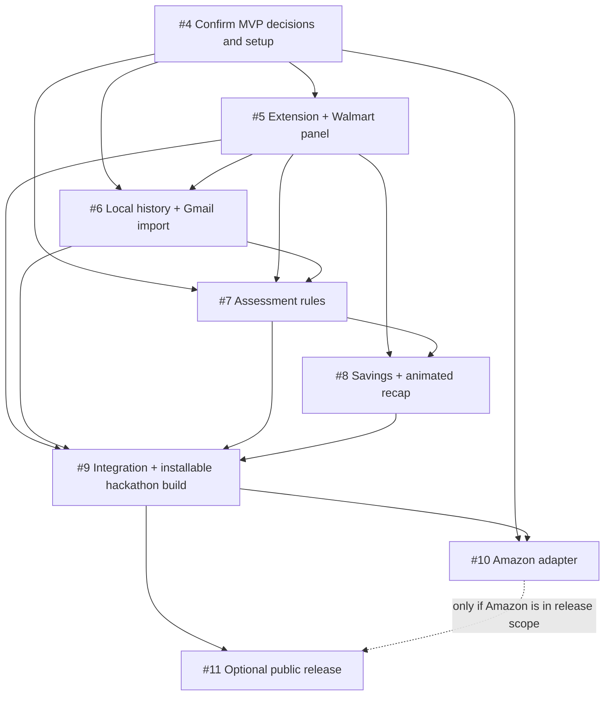

# Worth It — End-to-End Implementation Plan

**Purpose:** Ordered index of the GitHub issues needed to build Worth It.  
**Product requirements:** [PRD](PRD.md)  
**Technical baseline:** [Technical implementation specification](TECH_SPEC.md)  
**Planning issue:** [#3 — Create issue-linked end-to-end implementation plan](https://github.com/girwandhakal/WorthIt/issues/3)  
**Updated:** 2026-10-10

## How to use this plan

Each row links to a real GitHub issue. The issue body is the source of truth for that work package: it describes what to implement, the proposed project paths, dependencies, acceptance criteria, tests to add, commands to run, and completion evidence. Keep this file as the roadmap index; update its status and dependency links when issue scope changes.

Work through the issues in order, one issue at a time. Before coding, read the issue and the related sections of the PRD and technical specification. Implement on an issue branch from the latest `main`, open a PR targeting `main`, and include the issue link plus exact checks and results. Do not mark work complete until the issue acceptance criteria are met and required checks pass.

## Ticket order

| Order | Phase | GitHub issue | Outcome | Depends on | Status |
|---:|---|---|---|---|---|
| 0 | Planning | [#3 — Create issue-linked end-to-end implementation plan](https://github.com/girwandhakal/WorthIt/issues/3) | Maintain this roadmap and the linked issue set. | — | Open |
| 1 | Decision gate | [#4 — Finalize hackathon MVP decisions and owner-provided setup](https://github.com/girwandhakal/WorthIt/issues/4) | Resolve scope, behavior, evidence, and Gmail OAuth setup questions that affect implementation. | — | Open |
| 2 | Core MVP | [#5 — Build the Chrome extension foundation and Walmart checkout panel](https://github.com/girwandhakal/WorthIt/issues/5) | Create the extension skeleton, Walmart cart adapter, and accessible read-only checkout panel. | #4 | Open |
| 3 | Core MVP | [#6 — Add local purchase history and consent-based Gmail receipt import](https://github.com/girwandhakal/WorthIt/issues/6) | Store reviewed history locally and import synthetic/real receipts through the same optional Gmail API flow. | #4, #5; owner OAuth setup | Open |
| 4 | Core MVP | [#7 — Implement explainable item assessment rules and evidence-backed suggestions](https://github.com/girwandhakal/WorthIt/issues/7) | Assess store-brand value, repeat purchases, and only the approved narrow health concerns. | #4, #5, #6 | Open |
| 5 | Core MVP | [#8 — Add cart-level savings, investment illustration, and animated checkout recap](https://github.com/girwandhakal/WorthIt/issues/8) | Present item findings in an accessible animation, total potential savings, and show at most one aggregate investment illustration. | #5, #7 | Open |
| 6 | Hackathon delivery | [#9 — Integrate, validate, and package the hackathon-ready Worth It extension](https://github.com/girwandhakal/WorthIt/issues/9) | Verify the full Walmart/Gmail journey and produce the installable extension. | #5–#8 | Open |
| 7 | Follow-up retailer | [#10 — Add Amazon as the second retailer adapter](https://github.com/girwandhakal/WorthIt/issues/10) | Add Amazon support through the shared cart and assessment interfaces after the Walmart flow is stable. | #4, #9 | Open |
| 8 | Conditional public release | [#11 — Prepare optional public Chrome Web Store and Google OAuth release](https://github.com/girwandhakal/WorthIt/issues/11) | Prepare listing, privacy disclosures, and required Google/Chrome review if public distribution is approved. | #9; #10 only if Amazon is in public launch scope; owner approval | Open / deferred |

There are nine delivery issues after this index issue: eight implementation issues (#4–#11) plus this plan issue (#3). The first six tickets after the decision gate deliver the hackathon-ready Walmart experience. Amazon and public-store publication are later work; public distribution remains conditional on the owner's decision and external review.

## Dependency flow



## Product constraints carried through every ticket

- Worth It is an informational shopping assistant. It may add a pause and suggest alternatives, but the shopper performs every cart change and decides whether to buy.
- Assess all readable cart lines. Surface concise findings for meaningful concerns and say when an item cannot be assessed reliably.
- Prefer an available store brand for groceries. Claim similar ingredients/labels only when the product evidence supports that statement, and calculate savings only from known prices and quantities.
- Use purchase history as evidence of a prior purchase, not proof that an item is still owned or has been consumed. Treat ordinary consumables as restocking unless evidence supports a different concern.
- Health messages are limited to approved, evidence-backed triggers; most foods receive no health warning. Do not diagnose or claim that one item or serving causes disease.
- Keep personal financial accounts and personalized affordability/budget advice out of scope. Any investment illustration is hypothetical, uses the approved assumptions, applies once to aggregate current-cart potential savings, and is not repeated per item.
- For the hackathon walkthrough, fictional receipt-style emails are sent to the owner's Gmail and imported through the actual Gmail API flow. There is no runtime JSON seed or separate demo mode. Gmail is optional for ordinary use and requires explicit read-only consent.
- Keep data local; do not commit credentials, real email contents, private purchase data, or generated account-specific files.

## Test and completion standard

Implementation tickets #5–#11 require contributors to add or update automated tests in the paths listed by each issue. For each change, run the focused tests, then all applicable project checks:

```sh
npm run lint
npm run typecheck
npm run test
npm run test:e2e
npm run build
```

The foundation ticket (#5) establishes these commands and CI if they do not yet exist. A ticket is complete only when the relevant commands pass, the PR reports exact commands and results, and any live Gmail/retailer check that cannot run is identified with the fixture-based result and reason. Never report an unrun check as passing.

## Decisions and external inputs

Issue #4 is a blocking gate for user-visible behavior. In particular, do not invent health thresholds or silently decide what “AI-powered” means. The technical spec recommends explainable local rules, Walmart US first, and an optional aggregate investment illustration; the owner must confirm or change those recommendations in #4.

Issue #6 also needs the owner's OAuth setup before live Gmail verification: enable the Gmail API in a Google Cloud project, configure the extension OAuth client and test-user account, and supply the client ID through a safe configuration path. Do not request or store the owner's Google password or client secret.

Issue #11 is not required to finish or present the hackathon build. Keep it deferred unless the owner chooses public Chrome Web Store distribution and completes the required Google OAuth and Chrome Web Store review process.
