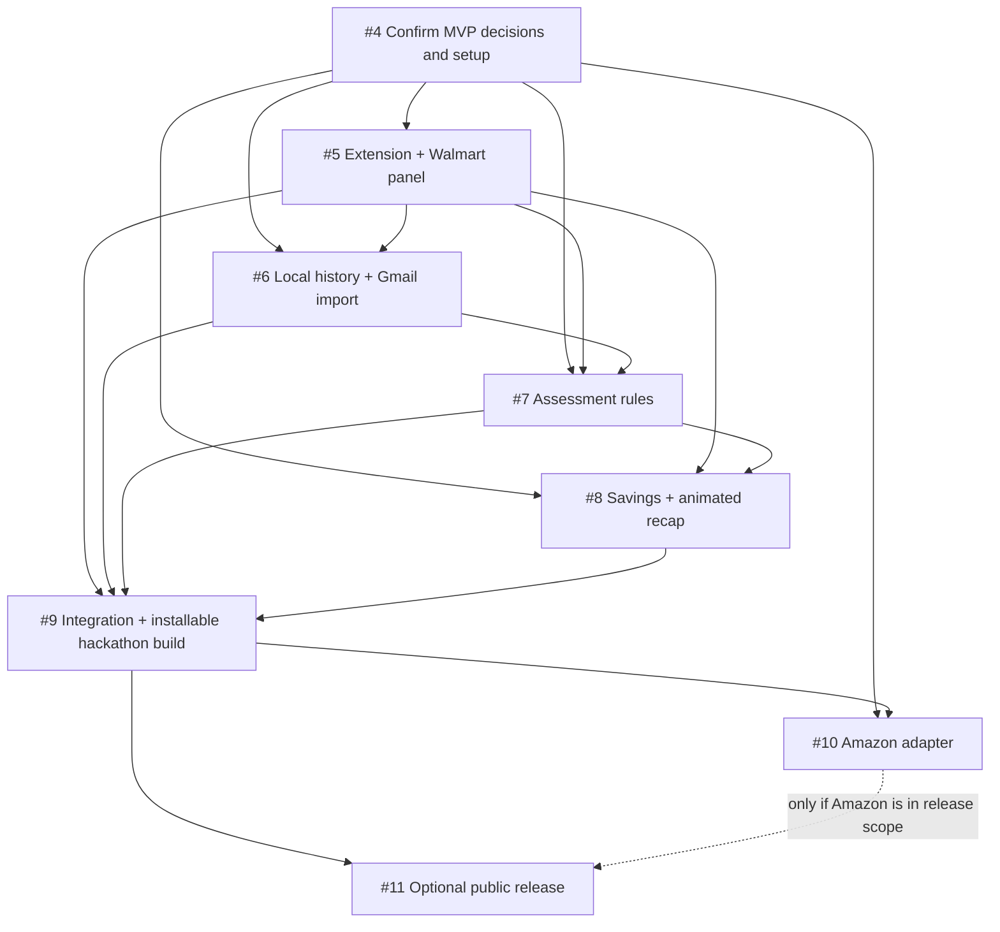

# Worth It — End-to-End Implementation Plan

**Purpose:** Ordered index of the GitHub issues needed to build Worth It.  
**Product requirements:** [PRD](PRD.md)  
**Technical baseline:** [Technical implementation specification](TECH_SPEC.md)  
**Planning issue:** [#3 — Create issue-linked end-to-end implementation plan](https://github.com/girwandhakal/WorthIt/issues/3)  
**Updated:** 2026-10-09

## How to use this plan

Each row links to a real GitHub issue. The issue body is the source of truth for that work package: it describes what to implement, the proposed project paths, dependencies, acceptance criteria, tests to add, commands to run, and completion evidence. Keep this file as the roadmap index; update its status and dependency links when issue scope changes.

Work through the issues in order, one issue at a time. Before coding, read the issue and the related sections of the PRD and technical specification. Implement on an issue branch from the latest `main`, open a PR targeting `main`, and include the issue link plus exact checks and results. Do not mark work complete until the issue acceptance criteria are met and required checks pass.

## Ticket order

| Order | Phase | GitHub issue | Outcome | Depends on | Status |
|---:|---|---|---|---|---|
| 1 | Decision gate | [#4 — Finalize hackathon MVP decisions and owner-provided setup](https://github.com/girwandhakal/WorthIt/issues/4) | Decisions recorded (TECH_SPEC section 1); still open: owner Gmail OAuth and OpenAI key setup. | — | Open |
| 2 | Core MVP | [#5 — Build the Chrome extension foundation and Walmart checkout panel](https://github.com/girwandhakal/WorthIt/issues/5) | Create the extension skeleton, Walmart cart adapter, CI (including fixture-based e2e), and accessible read-only checkout panel. | #4 | Done ([#21](https://github.com/girwandhakal/WorthIt/pull/21)) |
| 3 | Core MVP | [#6 — Add local purchase history and consent-based Gmail receipt import](https://github.com/girwandhakal/WorthIt/issues/6) | Add onboarding, preferences, and reviewed local history; import synthetic/real receipts through the same optional Gmail API flow; record opt-in observed purchases from order pages. | #4, #5; owner OAuth setup | Done ([#22](https://github.com/girwandhakal/WorthIt/pull/22)); live Gmail check awaits owner OAuth |
| 4 | Core MVP | [#7 — Implement explainable item assessment rules and evidence-backed suggestions](https://github.com/girwandhakal/WorthIt/issues/7) | Assess purpose/necessity, store-brand value, repeat purchases with one clarification question, and only the approved narrow health concerns. | #4, #5, #6 | Done ([#23](https://github.com/girwandhakal/WorthIt/pull/23)) |
| 5 | Core MVP | [#8 — Add cart-level savings, investment illustration, and animated checkout recap](https://github.com/girwandhakal/WorthIt/issues/8) | Present item findings in an accessible animation with OpenAI-phrased or template wording, total potential savings, and show at most one aggregate investment illustration. | #4, #5, #7 | Done; live OpenAI wording awaits the owner key |
| 6 | Hackathon delivery | [#9 — Integrate, validate, and package the hackathon-ready Worth It extension](https://github.com/girwandhakal/WorthIt/issues/9) | Verify the full Walmart/Gmail journey and produce the installable extension. | #5–#8 | Open |
| 7 | Follow-up retailer | [#10 — Add Amazon as the second retailer adapter](https://github.com/girwandhakal/WorthIt/issues/10) | Add Amazon support through the shared cart and assessment interfaces after the Walmart flow is stable. | #4, #9 | Open |
| 8 | Conditional public release | [#11 — Prepare optional public Chrome Web Store and Google OAuth release](https://github.com/girwandhakal/WorthIt/issues/11) | Prepare listing, privacy disclosures, and required Google/Chrome review if public distribution is approved. | #9; #10 only if Amazon is in public launch scope; owner approval | Open / deferred |

There are eight roadmap issues: one decision gate (#4) and seven delivery issues (#5–#11), which keeps the working roadmap under ten issues. Issue #3 tracked this planning document and is closed. Tickets #5–#9 deliver the hackathon-ready Walmart experience. Amazon and public-store publication are later work; public distribution remains conditional on the owner's decision and external review.

## Dependency flow



## Product constraints carried through every ticket

- Worth It is an advisor that makes shoppers think twice, not an analysis tool. It may add a pause, highlight at most three items with short advice or a question, and suggest alternatives, but the shopper performs every cart change and decides whether to buy. Scores, categories, tables, and charts stay out of the default view; the shopper can open “See full analysis” for the full per-item breakdown.
- Assess all readable cart lines on the supported cart page. With opt-in consent, read only item rows on order confirmation and purchase-history pages to record purchases; never read payment, address, or sign-in fields. Surface concise findings for meaningful concerns and say when an item cannot be assessed reliably. A cart with no findings gets only a collapsed indicator, not a recap.
- Prefer an available store brand for groceries. Claim similar ingredients/labels only when the product evidence supports that statement, and calculate savings only from known prices and quantities.
- Use purchase history as evidence of a prior purchase, not proof that an item is still owned or has been consumed. Treat ordinary consumables as restocking unless evidence supports a different concern.
- The only health message is the approved added-sugar note: any food or drink whose label lists added sugar gets it, and Worth It never suggests a product with added sugar. Items without added sugar get no health message. Do not quote Daily Value percentages, diagnose, or claim that one item or serving causes disease.
- Keep personal financial accounts and personalized affordability/budget advice out of scope. The investment illustration is on by default (the shopper can turn it off), is hypothetical, uses the approved assumptions, applies once to aggregate current-cart potential savings, and is not repeated per item.
- For the hackathon walkthrough, fictional receipt-style emails are sent to the owner's Gmail and imported through the actual Gmail API flow. There is no runtime JSON seed or separate demo mode. Gmail is optional for ordinary use and requires explicit read-only consent.
- Keep data local; do not commit credentials, real email contents, private purchase data, or generated account-specific files.

## Test and completion standard

Delivery tickets #5–#11 require contributors to add or update automated tests in the paths listed by each issue. For each change, run the focused tests, then all applicable project checks:

```sh
npm run lint
npm run typecheck
npm run test
npm run test:e2e
npm run build
```

The foundation ticket (#5) establishes these commands and a CI workflow that runs all five; `test:e2e` uses local fixture pages and stubbed Gmail/identity/OpenAI responses so it can run in CI. A ticket is complete only when the relevant commands pass, the PR reports exact commands and results, and any live Gmail/retailer check that cannot run is identified with the fixture-based result and reason. Never report an unrun check as passing.

## Decisions and external inputs

Issue #4 is a blocking gate for user-visible behavior. The assessment approach is already decided: deterministic, versioned criteria and calculations, with an LLM used only to phrase validated findings. The owner's decisions on retailers, product reference data ([Walmart reference products](WALMART_REFERENCE_PRODUCTS.md)), skip vs. cheaper-alternative suggestions, the category-to-purpose map, the OpenAI API, and observed-purchase recording are recorded in section 1 of the technical specification. The added-sugar health rule and the on-by-default investment illustration are also decided. Only the owner's Gmail OAuth and OpenAI key setup remain open in #4; they block live verification, not implementation.

Issue #6 also needs the owner's OAuth setup before live Gmail verification: enable the Gmail API in a Google Cloud project, configure the extension OAuth client and test-user account, and supply the client ID through a safe configuration path. Do not request or store the owner's Google password or client secret.

Issue #11 is not required to finish or present the hackathon build. Keep it deferred unless the owner chooses public Chrome Web Store distribution and completes the required Google OAuth and Chrome Web Store review process.
