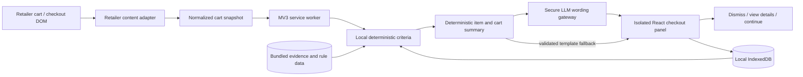

# Worth It — Technical Implementation Specification

**Status:** Proposed implementation baseline for the hackathon MVP  
**Product source:** [Product requirements](PRD.md)  
**Issue:** [#1 — Document Worth It technical implementation plan](https://github.com/girwandhakal/WorthIt/issues/1)

This document turns the current PRD into a buildable plan. It recommends a narrow, privacy-conscious Chrome extension that reads a supported checkout page, assesses each item using fixed deterministic criteria, summarizes applicable findings, and leaves every cart decision with the shopper.

## 1. Decisions at a glance

| Area | Recommended decision |
|---|---|
| Product | Worth It, an informational checkout assistant |
| Browser | Google Chrome, Manifest V3 |
| First retailer | Walmart US checkout/cart flow for the hackathon; Amazon is the next adapter |
| Language | TypeScript with strict checking |
| Extension tooling | WXT with Vite build pipeline |
| UI | React, TypeScript, CSS, and inline SVG/CSS animation |
| Local history | IndexedDB, wrapped with the small `idb` library; stores user-approved Gmail imports and other history locally |
| Cross-context messages | Typed browser runtime messages; validate all received payloads |
| Assessment | Fixed, versioned, deterministic criteria and calculations; each item produces structured criterion results with evidence and confidence |
| Summary language | An LLM API phrases a deterministic, validated cart summary naturally; it cannot score items, calculate values, add claims, or alter evidence |
| Remote services | No general application backend. A minimal server-side LLM gateway is required to protect provider credentials; Gmail API remains a separate direct, read-only OAuth flow |
| Personal finance | No account connection, balance, budget, or cash-flow data |
| Investment illustration | One optional aggregate-cart projection, using 10% assumed yearly return, annual compounding, 40 years, before inflation |
| Cart control | Read-only. Never add, remove, replace, or purchase an item |
| Animation | Short, skippable animated recap with captions and equivalent text |
| Release | Load unpacked for the hackathon; Chrome Web Store publication is a later step requiring listing assets and Google OAuth review for Gmail scope |

Worth It uses deterministic, versioned criteria to assess each item and calculate scores, prices, savings, and grouped cart statistics. An LLM API is used only to phrase already-verified findings and summary text in natural language. It must not select or change criteria, assign scores, classify purchases, calculate or alter numbers, invent evidence or sources, or add unsupported advice. Item names, numeric values, findings, and citations remain code-controlled fields. If the LLM is unavailable or its response fails validation, Worth It uses reviewed deterministic text templates. The provider, secure gateway hosting, credential setup, and exact data disclosure remain owner setup decisions in issue #4.

## 2. MVP boundary

The hackathon build should make one capability excellent: the pre-checkout cart review and animated recap. Assessment rules, history, savings, language assistance, and animation support that single user experience rather than becoming separate shallow features. Prioritize a complete, polished Walmart journey over more retailers or a long list of assessment categories.

The first usable slice should prove one complete journey:

1. The shopper opens a supported retailer cart or checkout page.
2. Worth It recognizes visible line items, quantities, and prices when available.
3. The extension assesses every recognized line item internally.
4. A compact panel summarizes only meaningful, supported observations and says when data is missing.
5. The panel may show store-brand savings, a recent similar purchase, or a qualifying nutrition note with its source.
6. It totals supported potential savings for the current cart and may show one optional projection at the end.
7. The shopper dismisses the panel, reviews evidence, or continues. They make all cart changes themselves. Purchase history can come from optional Gmail receipt import, manual entry, or retailer purchases recorded with consent. For the hackathon walkthrough, synthetic receipt emails sent to the owner's Gmail account go through the same Gmail API importer as real receipts.

Start with one retailer and a small set of product categories that can be demonstrated reliably. The PRD names Amazon and Walmart; this specification recommends Walmart US first because the grocery examples depend on grocery data. Confirm this retailer order before coding. Add Amazon through a separate adapter after the first full flow works.

Do not make computer vision, receipt OCR, account linking, cloud synchronization, or a universal product catalog part of the first release. A retailer page’s accessible text and structured DOM are the primary data source. The LLM is limited to wording a minimized, already-computed summary payload through the approved gateway; it is not the assessment engine or a video generator. Do not send raw page HTML, email bodies or attachments, Gmail tokens, or personal financial information to the LLM. Disclose any cart data sent to the selected provider. If product data cannot be read safely, show “Couldn’t assess this item” rather than guessing.

## 3. Architecture and data flow



### Responsibilities

- **Retailer content adapter:** Reads only the supported retailer page, using stable accessible labels and narrowly scoped selectors. Converts the retailer-specific markup to a common cart shape. It observes page changes and debounces updates. It does not click retailer controls or alter cart state.
- **Service worker:** Coordinates extension messages and access to extension APIs. It is short-lived in Manifest V3, so it must not keep essential state only in memory.
- **Assessment module:** Applies fixed, versioned rules to normalized cart items, local preferences, user-approved purchase records, and bundled evidence. Each item yields structured results for each criterion, including applicability/status, score where defined, evidence/source, confidence, and calculation inputs. “Not applicable” and “no concern” are distinct from “unknown.”
- **Summary builder:** Deterministically groups applicable item findings, calculates counts and cart totals, keeps alternative savings separate from possible remove/skip amounts and historical estimates, and prevents double counting. It omits non-applicable/no-concern criteria from the visible recap while retaining relevant uncertainty.
- **LLM wording gateway:** Receives only the minimum structured, already-verified summary fields needed to phrase the recap naturally. It may return wording only; fixed item names, criterion labels, scores, prices, savings, source details, and links come from validated code data. Validate responses and use reviewed templates on errors or unsupported output. Keep provider credentials on the server side, outside the extension.
- **Checkout panel:** Renders structured findings and the prebuilt animated recap inside an isolated Shadow DOM root to reduce style collisions. The visuals are populated from the recap data; no video is generated. All buttons are user-initiated and act only on Worth It’s interface.
- **Gmail receipt importer:** After the user chooses Connect Gmail and grants Google consent, requests a short-lived OAuth token, searches a bounded set of likely order messages with Gmail API `messages.list`, fetches selected messages with `messages.get`, parses them locally, and shows a review step before saving item records. It detects the fixed synthetic subject marker used by the hackathon receipt emails and marks those parsed records `synthetic_gmail`. It never sends, modifies, or deletes email.
- **Local data layer:** Stores settings, user-approved parsed purchase history, and feedback locally. It offers review, correction, export, and deletion operations from settings.
- **LLM gateway:** Accepts a constrained, size-limited request containing only the deterministic summary fields needed for wording, calls the selected provider server-side, and returns validated phrasing. It does not receive raw page/email data or calculate assessments; rate limiting, request validation, timeouts, and safe fallback behavior are required.
- **Bundled reference data:** Contains versioned health/evidence notes and conservative thresholds. Updates arrive only through a reviewed extension release; the extension does not execute remote code.

### Normalized cart item

Use a versioned TypeScript type with fields equivalent to:

- stable local item key;
- merchant identifier and product URL;
- title, brand, and category when detected;
- unit price, quantity, line price, currency, and price source;
- package size and unit price when available;
- ingredients/nutrition fields only when actually present on the page;
- observation time and extraction confidence.

Keep raw page text only in memory for extraction. Do not persist full page HTML, unrelated page content, checkout credentials, payment details, or browsing history. Do not ship a local synthetic history database or a separate demo mode. Create synthetic receipt emails in the owner's Gmail account; import them through the real Gmail API flow and retain an explicit `synthetic_gmail` provenance marker so the owner can distinguish test records from real purchases.

### Assessment result

Each item should return one result for every fixed criterion. A criterion result should include:

- criterion identifier and version;
- item identifier;
- applicability/status (`finding`, `no_concern`, `not_applicable`, or `unknown`);
- deterministic score and scale when that criterion uses one; do not convert not-applicable or unknown into zero;
- verified evidence values and source identifiers/URLs;
- confidence/data quality;
- suggested action, when applicable;
- current-cart potential reduction, if calculable.

Only applicable findings and material uncertainty are presented to the shopper. The deterministic summary builder groups related findings and computes all cart-level statistics. UI facts, amounts, scores, and source links are rendered from validated structured fields. Never let product names or page text become executable markup; escape retailer-provided strings.

## 4. Technology choices

### TypeScript, React, WXT

Use **TypeScript** for shared models and retailer adapters, with strict mode enabled. This catches mismatches between page extraction, assessment, storage, and UI before runtime.

Use **WXT** to generate the MV3 extension structure and support content-script entrypoints and development reload. Use **React** for the small settings and checkout-panel interfaces. Keep the UI as one compact surface rather than building a large dashboard before the checkout path works.

Use CSS transitions and inline SVG for the short animated summary. The extension renders a reusable sequence of visual scenes from the deterministic recap data; it does not generate or render a video file, and the LLM never creates the animation. Keep the assets and animation logic bundled with the extension. Respect reduced-motion settings and provide pause, replay, skip, captions, and an equivalent text/static view.

### Storage

Use **IndexedDB** for purchase history and any growing record set; wrap it with `idb` to keep transactions readable. Use `chrome.storage.local` for small extension preferences such as enabled retailers, whether the investment illustration is on, and reduced-motion preference. Do not put history in `storage.sync` or sync it to a server.

Use schema versioning and an explicit migration path. Store the source of each history record (`gmail_import`, `synthetic_gmail`, `manual`, or `observed_purchase`) and the purchase date, merchant, item, quantity, and price when available. Provide review, correction, and deletion. Synthetic Gmail records remain distinguishable from real Gmail imports. Disconnecting Gmail clears Worth It's cached OAuth token and does not delete already imported records unless the user chooses “remove imported records” too. Export is explicit and local; imports are schema- and size-validated.

### Gmail receipt import

Use the Chrome `identity` permission and an extension OAuth client configured in the Manifest V3 `oauth2` key. Request only `https://www.googleapis.com/auth/gmail.readonly`, and launch consent only from the user's Connect Gmail action after showing what the app will search and save. This scope is restricted and can read mailbox content, so it is materially broader than “receipts only.” Reduce practical access by searching within a user-selected date range and known retailer senders, fetching only matching messages, extracting order fields locally, then asking the user to review and confirm each proposed purchase record. Never retain email bodies, message attachments, or unrelated messages. Handle empty results as normal and offer manual entry. For the hackathon, seed the connected account with synthetic receipt emails sent to itself; query these by a fixed subject prefix such as `[Worth It Test Receipt]` and `from:me`, then parse them through the same importer as real order emails.

The extension calls Gmail API directly from its trusted extension context: `users.messages.list` with a constrained `q` and pagination, then `users.messages.get` for candidate IDs. Do not send a Gmail token to retailer content scripts or a server. Store no refresh token or OAuth client secret in source. Let Chrome Identity manage its token cache; provide an explicit disconnect action that clears the cached token and explains how to revoke Worth It's access in Google Account settings.

For your single-user hackathon build, put your own Google account on the OAuth consent screen's test-user list and use an extension OAuth client tied to the stable extension ID. Public distribution is a separate release gate: `gmail.readonly` is a restricted scope and requires Google OAuth verification; Google's current policy says restricted-scope data stored or transmitted on servers also requires a security assessment. Keep email processing local to avoid introducing that server-side data path. No general application backend is needed for cart assessment, deterministic rules, or Gmail calls. The selected LLM API requires a minimal server-side gateway to protect provider credentials. Do not add analytics SDKs.

## 5. Repository layout

```text
WorthIt/
├── README.md
├── AGENTS.md
├── package.json
├── package-lock.json
├── wxt.config.ts
├── tsconfig.json
├── .gitignore
├── .env.example                 # Empty placeholders only; never store provider credentials here
├── docs/
│   ├── PRD.md
│   ├── TECH_SPEC.md
│   └── IMPLEMENTATION_PLAN.md
├── public/
│   ├── icon/                    # Extension sizes required for browser surfaces
│   └── sources/                 # Optional bundled evidence metadata, no executable code
├── entrypoints/
│   ├── background.ts            # MV3 service worker
│   ├── popup/
│   │   ├── index.html
│   │   ├── main.tsx
│   │   └── App.tsx
│   ├── options/
│   │   ├── index.html
│   │   └── main.tsx
│   └── walmart.content.tsx      # Walmart-only adapter and isolated checkout panel
├── src/
│   ├── domain/
│   │   ├── cart.ts
│   │   ├── product.ts
│   │   ├── finding.ts
│   │   └── history.ts
│   ├── ingestion/
│   │   └── gmail/
│   │       ├── oauth.ts
│   │       ├── search-orders.ts
│   │       ├── parse-message.ts
│   │       └── review-import.ts
│   ├── adapters/
│   │   ├── retailer-adapter.ts
│   │   └── walmart/
│   │       ├── selectors.ts
│   │       ├── extract-cart.ts
│   │       └── observe-cart.ts
│   ├── assessment/
│   │   ├── assess-cart.ts
│   │   ├── summarize-cart.ts
│   │   ├── rules/
│   │   │   ├── store-brand.ts
│   │   │   ├── repeat-purchase.ts
│   │   │   ├── nutrition.ts
│   │   │   └── investment.ts
│   │   └── evidence/
│   │       └── sources.ts
│   ├── summary/
│   │   ├── phrase-summary.ts
│   │   └── validate-phrasing.ts
│   ├── storage/
│   │   ├── database.ts
│   │   ├── migrations.ts
│   │   └── repositories.ts
│   ├── messaging/
│   │   ├── messages.ts
│   │   └── validate-message.ts
│   ├── ui/
│   │   ├── checkout/
│   │   ├── animation/
│   │   └── shared/
│   └── shared/
│       ├── currency.ts
│       ├── calculations.ts
│       └── validation.ts
├── server/
│   └── summary-gateway/           # Minimal server-side LLM proxy; provider key stored as deployment secret
│       ├── handler.ts
│       └── validate-request.ts
├── tests/
│   ├── fixtures/
│   │   ├── retailer/             # Sanitized, synthetic retailer DOM snapshots
│   │   └── email/                # Fictional MIME / .eml receipt parser cases
│   ├── unit/
│   ├── integration/
│   └── e2e/
└── .github/
    └── workflows/
        └── ci.yml
```

Keep retailer-specific selectors out of rules and UI. A second retailer should add a new adapter and tests without changing the normalized assessment model.

## 6. Permissions, privacy, and security

Start with the smallest permissions that can support the selected checkout flow:

- `storage` for extension preferences and `identity` only if Gmail import is included;
- host access for the single supported retailer plus `https://gmail.googleapis.com/*`, requested explicitly in the manifest;
- OAuth client configuration for the one required restricted scope `https://www.googleapis.com/auth/gmail.readonly`;
- no tabs, history, cookies, webRequest, downloads, or broad all-sites access unless an implemented feature proves it is necessary.

Add another retailer’s host permission only when its adapter is ready. Explain in onboarding that Worth It reads cart product names, displayed prices, and relevant label details on supported retailer pages. Gmail must be a separate, optional connection with just-in-time consent; show the exact purpose, date range, message search, parsed fields, and review step. Users can disconnect Gmail and inspect, correct, or delete imported records. The single-user hackathon OAuth project can stay in testing while your account is its test user; public rollout requires Google verification for the restricted Gmail scope.

Security requirements:

- Run all executable code from the packaged extension; no remotely hosted scripts, dynamic code evaluation, or inline event handlers.
- Validate every message crossing from content script to service worker.
- Treat retailer DOM as untrusted input.
- Render plain text, not unsanitized HTML.
- Keep sensitive storage restricted to trusted extension contexts where supported.
- Do not store payment details, login credentials, full page snapshots, raw email bodies, attachments, or personal financial data.
- Keep the extension’s Content Security Policy restrictive.
- Make data collection, retention, export, and deletion match the Chrome Web Store disclosure and privacy policy before public release.

## 7. Assessment rules and calculation behavior

Keep decision criteria deterministic, versioned, and explainable. Each item receives a structured result for every criterion: applicable finding, no concern, not applicable, or unknown due to insufficient evidence. Define a score and scoring scale only for criteria that use one. Do not treat not-applicable or unknown as a zero score. The recap omits non-applicable and no-concern results, but surfaces material uncertainty where it affects the shopper's decision.

A deterministic summary builder groups applicable results and computes all statistics and money values from validated item data. It is the sole authority for scores, classifications, counts, percentages, savings, and investment calculations. The LLM receives this finalized summary payload only to phrase concise, natural-language explanations. It must not choose which findings apply or create, change, or calculate facts. Render numeric values, criterion labels, evidence, and citations from the validated payload rather than accepting replacements from generated wording. Reject invalid output and fall back to reviewed templates. Never count mutually exclusive savings paths twice.

- **Store brand:** Prefer an available store-brand suggestion as requested by the PRD. State the real per-unit and basket price difference. Claim “similar ingredients” only when retrieved labels support it. If the store brand is not cheaper, do not claim savings. Expose a material package, ingredient, or dietary mismatch.
- **Past grocery savings:** Use recorded quantities and either recorded historical prices or clearly labeled present-day price differences applied to historical quantities. Keep this hypothetical estimate separate from current-cart savings.
- **Repeat purchases:** Match normalized names/brands and cautiously compare category/purpose. A prior receipt proves purchase, not current ownership or use. Consumables can be routine restocking. Ask one brief question when the context would change the advice.
- **Health note:** Trigger only for a narrow, reviewed category/threshold and reliable item evidence. Use a credible source, describe population-level evidence carefully, and offer a short optional suggestion. Do not diagnose, claim one serving causes a disease, or give warnings for routine items. If nutrition data is missing, do not infer it from a title alone.
- **Cart summary:** Separate (1) lower-priced alternative savings and (2) the amount the user might avoid by removing a flagged item. Label both as potential, not realized, savings. Do not count the same item twice.
- **Investment illustration:** Only once at the end and only from aggregate current-cart potential savings. With principal (P), annual rate (r=0.10), yearly compounding, and (n=40), calculate (FV=P(1+r)^n). For $5, this is about $226.30 before inflation, fees, taxes, and uncertainty. State the assumed rate and term. This is an illustration, not a forecast or promise. Do not show item-level projections or use personal finances.

Prices and savings must use decimal-safe currency arithmetic (integer minor units such as cents), not floating point for money totals. Group counts and percentages must use documented denominators and deterministic rounding; when the denominator or underlying data is unavailable, omit the statistic rather than ask the LLM to estimate it.

### LLM wording and data boundary

The LLM API is a wording assistant, not an evaluator. Send only the minimum validated summary data needed for natural phrasing, such as applicable finding labels and explanations. Never send raw retailer-page content, raw Gmail messages or attachments, OAuth tokens, or personal financial data. Disclose the data transfer before use. Keep the provider API key in a server-side gateway secret store, never in extension code or configuration shipped to Chrome. Validate returned text against the supplied finding IDs and fixed numeric/source fields; provide deterministic reviewed wording if the service is unavailable, slow, or returns unsupported content.

## 8. User interface behavior

At checkout, present a short visual sequence:

1. “Worth It reviewed your cart” with the number of items assessed.
2. The deterministic summary groups applicable findings by criterion or concern and omits non-applicable and no-concern checks.
3. Each flagged item shows its name, plain-language reason, evidence, and certainty. The LLM may phrase explanations naturally, but criterion labels, numbers, sources, and links come from validated structured data.
4. Store-brand suggestions show the actual unit and cart price difference where available.
5. Repeat-purchase notes acknowledge uncertainty and ask one useful question only if needed.
6. Qualifying health notes include a concise source and practical phrasing.
7. Total potential current-cart reduction is clearly distinct from estimated historical savings.
8. One optional aggregate investment illustration appears at the end.
9. Controls let the shopper pause, replay, read captions/details, dismiss, or continue.

Never say “bad choice,” shame the shopper, or imply that an item is forbidden. “Consider skipping or reducing this item” can be offered for a qualifying concern; the shopper remains in charge. The recap must not block the retailer’s checkout. If animation is unavailable, reduced, or skipped, show the same information in a readable static panel. Keyboard navigation and screen-reader labels are required.

## 9. Local development and package scripts

Use Node.js LTS supported by the current WXT release, npm, and a committed lockfile. Pin dependency ranges intentionally and use reproducible installs in CI. Do not include API secrets in source control.

Expected scripts:

- `dev`: launch WXT with the selected Chrome target and local extension reload;
- `build`: produce the unpacked MV3 build;
- `zip`: package a release artifact;
- `typecheck`: run TypeScript without emitting files;
- `lint`: run ESLint on source;
- `test`: run Vitest unit/integration checks;
- `test:e2e`: run Playwright against bundled Chromium with a persistent extension context.

Exact WXT command flags should be taken from the installed version’s generated project and verified against that version’s docs, rather than copied from an older guide.

## 10. Test and quality plan

Do not begin with live retailer automation. Build confidence in layers:

1. **Unit tests:** currency rounding, aggregate savings, compound-growth math, item normalization, duplicate matching, nutrition threshold logic, criterion scores and applicability, grouped summary statistics, and evidence/source rendering.
2. **Adapter tests:** sanitized HTML fixtures for cart rows, quantity changes, discounts, missing prices, multi-quantity lines, and page rerenders.
3. **Assessment tests:** each criterion’s positive, negative, not-applicable, unknown, and boundary cases; ensure missing data never becomes a health or savings claim.
4. **Summary/LLM tests:** verify deterministic grouping and calculations, no double counting, stable text fallback, response validation, and that model output cannot alter scores, numbers, sources, or add a finding.
5. **UI tests:** captions, keyboard controls, reduced motion, dismiss/continue, and no cart-edit actions.
6. **End-to-end:** load the unpacked extension in Chromium with a persistent context and local test fixture pages that mimic the supported retailer DOM.
7. **Email parsing tests:** use fictional `.eml`/MIME fixtures to test HTML and plain-text parsing, missing fields, duplicates, malformed payloads, and injection-like text. Tests must prove the email body is discarded after extraction and nothing is sent to a server.
8. **Synthetic Gmail receipts:** send several fictional order-confirmation emails to the owner's own Gmail account, with a fixed subject prefix `[Worth It Test Receipt]` and varied purchase dates, products, quantities, prices, and return/cancel cases. The extension must find them through Gmail API and import them through the normal review flow, tagging them `synthetic_gmail`. Do not seed a local JSON history at runtime or put real email content into the repository.
9. **Manual retailer smoke check:** use a developer’s test cart, check page changes and selectors, and verify no interactions modify the cart. Retailer HTML may change; handle extraction failure visibly.

CI should install from the lockfile and run lint, typecheck, unit/integration tests, and production build. Keep screenshots and fixture data synthetic or scrubbed of account details. The user has asked for a spec, not implementation; checks begin when the code exists.

## 11. Implementation plan and issue order

Use the [end-to-end implementation plan](IMPLEMENTATION_PLAN.md) as the current roadmap index. It links each delivery stage to its GitHub issue, dependencies, and status. The detailed issue bodies define scope, proposed source paths, acceptance criteria, tests, commands, and completion evidence.

Complete work in this order:

1. [#4 — Finalize hackathon MVP decisions and owner-provided setup](https://github.com/girwandhakal/WorthIt/issues/4)
2. [#5 — Build the Chrome extension foundation and Walmart checkout panel](https://github.com/girwandhakal/WorthIt/issues/5)
3. [#6 — Add local purchase history and consent-based Gmail receipt import](https://github.com/girwandhakal/WorthIt/issues/6)
4. [#7 — Implement explainable item assessment rules and evidence-backed suggestions](https://github.com/girwandhakal/WorthIt/issues/7)
5. [#8 — Add cart-level savings, investment illustration, and animated checkout recap](https://github.com/girwandhakal/WorthIt/issues/8)
6. [#9 — Integrate, validate, and package the hackathon-ready Worth It extension](https://github.com/girwandhakal/WorthIt/issues/9)
7. [#10 — Add Amazon as the second retailer adapter](https://github.com/girwandhakal/WorthIt/issues/10), after the Walmart vertical slice is stable.
8. [#11 — Prepare optional public Chrome Web Store and Google OAuth release](https://github.com/girwandhakal/WorthIt/issues/11), only if the owner chooses public distribution.

Issue #4 remains a decision gate for the exact health thresholds, Gmail owner setup, investment default, and the LLM provider/gateway and data disclosure. The assessment approach is decided: criteria, scores, calculations, and grouped statistics are deterministic; the LLM may only phrase the validated summary. Do not begin blocked implementation work until the remaining relevant decisions and setup are recorded. Implement one issue at a time on a focused branch from the latest `main`; each PR must link its issue and report the exact tests/checks run and their results.

## 12. Packaging and release

For the hackathon deliverable, build the actual extension package and load it through Chrome’s extension developer mode. Configure Gmail OAuth in testing state with your own Google account as the test user. Send the synthetic order emails to that same account and import them through the actual Gmail API path. The email subject marker identifies generated records; this is not a separate mode or local JSON dataset. Never commit OAuth secrets or personal email content.

For public Chrome Web Store and Google OAuth release, the owner will need to provide or approve:

- listing name, description, screenshots, promotional graphics, and support contact;
- public privacy policy URL describing exact local and remote data flows;
- accurate single-purpose and data-use disclosures;
- final requested host permissions and justification;
- developer account and any applicable publishing fee/account requirements.

Submit only after the extension’s behavior, permission prompts, listing claims, and privacy disclosures agree. Chrome Web Store policy is subject to change; recheck official submission rules at release time.

## 13. Owner inputs needed before coding

The plan can proceed with defaults except where these choices alter user-visible behavior or data handling:

1. Confirm Walmart US is the first hackathon retailer, with Amazon second.
2. Choose the LLM provider and approve the minimal server-side gateway/hosting and data disclosure for sending minimized cart-summary fields for wording only. Never place its API key in the extension; no model or gateway may change assessments or numeric results.
3. Provide a Google Cloud project with Gmail API enabled, configure the OAuth consent screen in testing, add your own Google account as a test user, and provide the extension OAuth client ID. No password, API secret, or personal receipt sample needs to be sent to me. Decide whether observed future purchases should be recorded with opt-in consent.
4. Approve the specific health triggers, numeric thresholds, source wording, and reviewed claims. Do not ship a health rule based only on an example such as “candy” or “chips.”
5. Confirm whether aggregate investment illustration is enabled by default or is an opt-in setting.
6. Provide a Chrome profile where you can authorize your Google account and access your Gmail test inbox, plus a retailer test cart or local retailer fixtures. Do not share your password or payment details.
7. For public store release, supply the listing/support/privacy materials listed above.

Gmail API uses an OAuth extension client ID and your consent, not an API key. Bank connections, retailer logins, payment data, and personal financial analysis remain out of scope. Your own synthetic receipt emails supply repeat-purchase test cases through the same Gmail API path if you do not have real retailer receipts.

## 14. Risks and mitigations

| Risk | Mitigation |
|---|---|
| Retailer markup changes | Isolate selectors in adapters; fixture tests; fail visibly and safely |
| Product false match | Require conservative match confidence; show evidence; ask one question |
| Unsupported savings claim | Compute only from observed prices/quantity; use integer cents; disclose estimate basis |
| Health overclaim | Narrow reviewed triggers, authoritative sources, qualified wording, no inference from title |
| Broad extension access | One retailer permission at a time; explain and request only required host access |
| Animation obscures details | Captions, text equivalent, reduced motion, pause/skip, accessible focus order |
| LLM wording changes or invents facts | Keep criteria and calculations deterministic, validate wording against structured findings, render numeric/source fields from code, and fall back to reviewed templates |
| Hackathon time pressure | One retailer, a few evidence-backed scenarios, synthetic fixtures |

## 15. Plain-English summary

Worth It should be a small Chrome add-on that reviews the supported shopping cart and gives the shopper a short, evidence-based pause before checkout. It can find likely order receipts in Gmail after you explicitly connect your account, show you parsed purchase records for confirmation, and keep approved history on your device. Synthetic receipt emails sent to your own Gmail account provide repeat-purchase test cases when your real mailbox has no matching receipts. The extension can point out a cheaper store brand, a recent similar purchase, or a well-supported nutrition concern; it totals potential savings and may show one aggregate investment illustration. It never edits the cart or uses bank information.

For the hackathon build, use TypeScript/React/WXT, local IndexedDB, and Gmail API read-only OAuth for your own test account. Send synthetic receipt emails to that account and let Worth It find and parse them through the same receipt importer used for real messages. Gmail read access is broad even when searches are constrained; keep processing local and require review before saving each imported record. The product applies fixed rules to every cart item, computes scores and summary statistics deterministically, then may use an LLM through a secure gateway only to make verified feedback sound natural. The checkout recap uses prebuilt animation populated by those results, not generated video.

## 16. Primary documentation

These links were checked while preparing the plan. Recheck version-specific details when implementation begins.

- [Chrome Extensions: Manifest V3 overview](https://developer.chrome.com/docs/extensions/develop/migrate/what-is-mv3)
- [Chrome Extensions: service worker lifecycle](https://developer.chrome.com/docs/extensions/develop/concepts/service-workers/lifecycle)
- [Chrome Extensions: content scripts](https://developer.chrome.com/docs/extensions/develop/concepts/content-scripts)
- [Chrome Extensions: declare permissions](https://developer.chrome.com/docs/extensions/develop/concepts/declare-permissions)
- [Chrome Extensions: storage API](https://developer.chrome.com/docs/extensions/reference/api/storage)
- [Chrome Extensions: Content Security Policy](https://developer.chrome.com/docs/extensions/reference/manifest/content-security-policy)
- [Chrome Extensions: identity API](https://developer.chrome.com/docs/extensions/reference/api/identity)
- [Chrome Extensions: OAuth 2.0 manifest key](https://developer.chrome.com/docs/extensions/reference/manifest/oauth2)
- [Gmail API: authorization scopes and restricted-scope requirements](https://developers.google.com/workspace/gmail/api/auth/scopes)
- [Gmail API: list messages](https://developers.google.com/workspace/gmail/api/guides/list-messages)
- [Gmail API: search and filter messages](https://developers.google.com/workspace/gmail/api/guides/filtering)
- [Google Cloud: OAuth app verification](https://support.google.com/cloud/answer/13463073?hl=en)
- [Google Cloud: unverified app testing](https://support.google.com/cloud/answer/7454865?hl=en)
- [Chrome Web Store: user data FAQ](https://developer.chrome.com/docs/webstore/program-policies/user-data-faq)
- [Chrome Web Store: program policies](https://developer.chrome.com/docs/webstore/program-policies/policies)
- [Chrome Web Store: publish an item](https://developer.chrome.com/docs/webstore/publish)
- [WXT: entrypoints](https://wxt.dev/guide/essentials/entrypoints)
- [WXT: content scripts](https://wxt.dev/guide/essentials/content-scripts)
- [React: thinking in React](https://react.dev/learn/thinking-in-react)
- [TypeScript: handbook introduction](https://www.typescriptlang.org/docs/handbook/intro.html)
- [Vitest: guide](https://vitest.dev/guide/)
- [Playwright: Chrome extensions](https://playwright.dev/docs/chrome-extensions)
- [CDC: added sugars and health](https://www.cdc.gov/nutrition/php/data-research/added-sugars.html)
- [WHO: non-sugar sweeteners guideline](https://www.who.int/publications/i/item/9789240073616)
