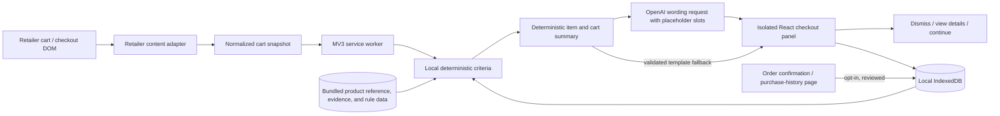

# Worth It — Technical Implementation Specification

**Status:** Proposed implementation baseline for the hackathon MVP  
**Product source:** [Product requirements](PRD.md)  
**Issue:** [#1 — Document Worth It technical implementation plan](https://github.com/girwandhakal/WorthIt/issues/1)

This document turns the current PRD into a buildable plan. It recommends a narrow, privacy-conscious Chrome extension that reads a supported cart page deterministically from its visible cart structure, assesses each item using fixed criteria, summarizes applicable findings, and leaves every cart decision with the shopper.

## 1. Decisions at a glance

| Area | Decision |
|---|---|
| Product | Worth It, an informational checkout assistant |
| Browser | Google Chrome, Manifest V3 |
| First retailer | Walmart US cart page for the hackathon; Amazon is the next adapter |
| Supported pages | The Walmart cart page for the review. With opt-in consent, also the order confirmation page and the purchase-history (orders) page, reading only item rows, to record purchases. Never read payment, address, or sign-in fields |
| Product reference data | Bundled, reviewed records from [Walmart reference products](WALMART_REFERENCE_PRODUCTS.md), keyed by retailer item ID; store-brand prices are last-checked prices labeled as estimates |
| Language | TypeScript with strict checking |
| Extension tooling | WXT with Vite build pipeline |
| UI | React, TypeScript, CSS, and inline SVG/CSS animation |
| Local history | IndexedDB, wrapped with the small `idb` library; stores user-approved Gmail imports and other history locally |
| Cross-context messages | Typed browser runtime messages; validate all received payloads |
| Assessment | Fixed, versioned, deterministic criteria and calculations; each item produces structured criterion results with evidence and confidence |
| Summary language | The OpenAI API phrases a deterministic, validated cart summary naturally; it cannot score items, calculate values, add claims, or alter evidence |
| Remote services | No backend for the hackathon. The extension calls the OpenAI API directly with an API key the owner enters in settings, and works without it by using reviewed templates. Gmail API remains a separate direct, read-only OAuth flow. A server-side proxy for the OpenAI key is required only before public release |
| Personal finance | No account connection, balance, budget, or cash-flow data |
| Investment illustration | One aggregate-cart projection, on by default (can be turned off in settings), using 10% assumed yearly return, annual compounding, 40 years, before inflation |
| Cart control | Read-only. Never add, remove, replace, or purchase an item |
| Animation | Short, skippable animated recap with captions and equivalent text |
| Release | Load unpacked for the hackathon; Chrome Web Store publication is a later step requiring listing assets and Google OAuth review for Gmail scope |

Worth It uses deterministic, versioned criteria to assess each item and calculate scores, prices, savings, and grouped cart statistics. An LLM API is used only to phrase already-verified findings and summary text in natural language. It must not select or change criteria, assign scores, classify purchases, calculate or alter numbers, invent evidence or sources, or add unsupported advice. Item names, numeric values, findings, and citations remain code-controlled fields. If the LLM is unavailable or its response fails validation, Worth It uses reviewed deterministic text templates.

### Recorded owner decisions (issue #4)

Recorded 2026-10-09:

1. **Retailers:** Walmart US first and in the walkthrough. Every retailer-specific behavior lives in an adapter, so a production build supports Walmart and Amazon through the same models; Amazon follows in issue #10.
2. **Product reference data:** A bundled list of real Walmart name-brand and store-brand products with prices last checked on Walmart.com, kept in [Walmart reference products](WALMART_REFERENCE_PRODUCTS.md). The walkthrough cart is built from those products. This is reference data used by the real extension, not a separate demo mode.
3. **Skip vs. cheaper alternative:** Worth It suggests skipping an item only when it looks useless for this shopper: a similar non-consumable was bought recently (and no clarification answer says it is a replacement or for a different purpose), or the item is a novelty/trend item with no practical use. Otherwise it suggests a cheaper alternative when one exists. A trend item that does have a use (for example a name-brand tumbler) gets the cheaper alternative, or a skip suggestion if a similar item was bought recently. The combined savings total counts each item once, using its primary suggestion (section 7).
4. **Purpose classes:** Essential items are grocery staples and whole foods, basic household consumables, low-cost basic clothing not bought recently, basic household non-consumables not bought recently, personal hygiene, over-the-counter medicine and first aid, baby care basics, and pet food. Section 7 has the full map and thresholds.
5. **Language model:** OpenAI API. For the single-user hackathon build, the owner pastes their own OpenAI API key into Worth It's settings; there is no hosted gateway.
6. **Observed purchases:** In scope. With opt-in consent, Worth It records purchases from the retailer's order confirmation page and, on request, from the purchase-history page, after the shopper reviews them.

7. **Food decision tree (supersedes “added sugar only”):** Food is judged from its own product page (ingredients, Nutrition Facts, category). A food with nothing flagged gets no comment; otherwise the approved concerns are added sugar (the original approved note), cured/processed meat, artificial trans fat, non-sugar sweeteners (named), high sodium per serving, synthetic dyes, and ultra-processed ingredients, each with fixed reviewed wording and one vetted source. Non-food is flagged only as a novelty item with no practical use (“probably not worth it”). Worth It never suggests a product with added sugar or one of the flagged concerns as a store-brand switch. Details in section 7.
8. **Investment illustration:** On by default; the shopper can turn it off in settings. It appears once, after the total, as: “By following these suggestions, you would save $X. If you invested that $X at an assumed 10% annual return, compounded annually, it could grow to about $Y in 40 years (before inflation; returns are not guaranteed).”

Still open in issue #4: only the owner's Gmail OAuth and OpenAI key setup.

## 2. MVP boundary

The hackathon build should make one capability excellent: the pre-checkout cart review and animated recap. Assessment rules, history, savings, language assistance, and animation support that single user experience rather than becoming separate shallow features. Prioritize a complete, polished Walmart journey over more retailers or a long list of assessment categories.

The first usable slice should prove one complete journey:

1. The shopper opens the supported retailer cart page.
2. Worth It recognizes visible line items, quantities, and prices when available, and looks up each item in the bundled product reference data.
3. The extension assesses every recognized line item internally.
4. If nothing merits attention, Worth It shows only a small collapsed “Reviewed N items” indicator; no recap plays, no panel opens on its own, and the checkout click is not held.
5. Otherwise the collapsed indicator stays up and nothing pops open on load. When the shopper clicks the retailer's checkout control, a capture-phase listener holds that first real click once (`preventDefault` and `stopImmediatePropagation`, never a synthetic click) and opens a compact panel that summarizes only meaningful, supported observations and says when data is missing. The listener is armed only while there is an un-dismissed finding worth acting on (a store-brand note with no savings is only a footnote and never arms it), the panel is mounted, and it is not already open; it disarms after one hold or any dismissal, re-arms on every new visit to the cart page (the first review of a visit carries `fresh: true`, which clears that tab's dismissals), is removed off the cart route, and ignores untrusted events. Control detection is per retailer (`isCheckoutControl`: the retailer's own selector, else a “checkout” label on a button or link). Worth It never clicks the control; the shopper's next click goes through.
6. The panel may show store-brand savings, a recent similar purchase, or a qualifying nutrition note with its source.
7. It totals supported potential savings for the current cart and, by default, shows one investment projection at the end.
8. The shopper dismisses the panel, reviews evidence, or continues. They make all cart changes themselves.

Purchase history comes from manual entry, optional Gmail receipt import, and opt-in recording of purchases observed on the retailer's order confirmation and purchase-history pages. For the hackathon walkthrough, synthetic receipt emails sent to the owner's Gmail account go through the same Gmail API search, fetch, parse, and review pipeline as real receipts.

### Hackathon acceptance walkthrough

Use items from [Walmart reference products](WALMART_REFERENCE_PRODUCTS.md), quantity 1 each, and recheck prices first; the amounts below use the 2026-10-09 prices.

1. **Setup:** Load the unpacked extension in Chrome, complete onboarding, opt in to purchase recording, and paste the OpenAI key in settings. Connect Gmail and import the synthetic receipts, which include a 30 oz tumbler bought 20 days ago. Review the records and save them; they show as synthetic.
2. **Normal cart:** A cart with only store-brand staples that have no added sugar (for example Great Value milk, eggs, and long-grain rice) shows the collapsed “Reviewed 3 items” indicator. No recap plays.
3. **Mixed cart:** Horizon Organic milk, Kraft shredded mild cheddar, Bounty Essentials paper towels, Diet Coke, a Stanley 30 oz tumbler, a 5-inch Squishmallows plush, and Skittles. The recap opens with “Before you check out, 3 things are worth a second thought,” highlights the three biggest savings (the tumbler, the Skittles, then the plush) in that order, and rolls the rest into one line (“You also had 3 other items you could reconsider or swap for a different one, worth about $4.81 more.”). The paper towels appear only in the expanded details. Choosing “See full analysis” lists all seven items with their checks, prices, and sources. The underlying findings are:
   - Store-brand savings: milk $1.99, cheddar $1.01, Diet Coke $1.81. These assume the recorded labels show 0 g added sugar for each store-brand item; a store brand with added sugar is never suggested.
   - Paper towels: the Great Value option is named but costs more per sheet, so no savings are claimed.
   - Tumbler: a similar tumbler was bought 20 days ago, so Worth It suggests skipping it ($24.97) and asks whether it replaces the earlier one.
   - Plush: a novelty item, so Worth It suggests skipping it ($3.97).
   - Skittles: the label lists added sugar, so Worth It shows the added-sugar note and suggests skipping it or choosing a smaller amount ($4.97).
   - Combined potential reduction and illustration: “By following these suggestions, you would save $38.72. If you invested that $38.72 at an assumed 10% annual return, compounded annually, it could grow to about $1,752.44 in 40 years (before inflation; returns are not guaranteed).”
4. **Clarification:** Answer “Replacing a worn one” for the tumbler. The skip suggestion is withdrawn and the Ozark Trail tumbler is suggested instead ($12.00 less). The total becomes $25.75, and the illustration becomes about $1,165.43.
5. **Control:** Pause, replay, and skip the recap, then press Continue. The panel closes; the Walmart cart is unchanged and checkout still works normally.
6. **Purchase recording:** Open the Walmart purchase-history page, choose “Record these purchases,” review the parsed items, and save them as observed purchases.

Start with one retailer and a small set of product categories that can be demonstrated reliably. Walmart US is first because the grocery examples depend on grocery data; add Amazon through a separate adapter after the first full flow works.

Do not make computer vision, receipt OCR, account linking, cloud synchronization, or a universal product catalog part of the first release. A retailer cart page’s accessible text and structured DOM are the source for what is in the cart, its quantities, and its displayed prices. Walmart cart rows do not show ingredients, nutrition facts, reliable category, or a store-brand counterpart, so those facts come from the bundled [Walmart reference products](WALMART_REFERENCE_PRODUCTS.md), which cover the walkthrough products and common staples. Each reference record carries its source, the date it was checked, and a reviewer; a reference price for an alternative that is not in the cart is shown with that date as a last-checked price, and any savings calculated from it are labeled as an estimate. Prices for items in the cart always come from the live cart page; Worth It does not fetch store-brand product pages. The LLM is limited to wording a minimized, already-computed summary payload; it is not the assessment engine or a video generator. Do not send raw page HTML, email bodies or attachments, Gmail tokens, or personal financial information to the LLM. Disclose any cart data sent to the selected provider. If product data cannot be read safely, show “Couldn’t assess this item” rather than guessing.

## 3. Architecture and data flow



### Responsibilities

- **Retailer content adapter:** Reads only the supported retailer’s visible cart rows, using stable accessible labels and narrowly scoped selectors. It copies available product names, displayed prices, and quantities into a common cart shape; it does not use an LLM or computer vision to identify cart values, crawl other pages, run background scraping, click retailer controls, or alter cart state. The one approved extra read is each cart item’s own product page (see “Product page reader”). If expected fields are missing or markup changes, it reports unknown values rather than guessing. It observes cart-page changes and debounces updates. Walmart is a single-page application, so the content script matches the Walmart origin, listens for client-side location changes, and activates only while the URL is the cart route; it stays inert on every other Walmart page, including checkout and payment pages, except the opt-in purchase recorder below.
- **Product page reader (Walmart):** For each distinct item ID in the cart, the content script requests that item’s own product page from the shopper’s session (same origin), parses the embedded page data into `ProductFacts` (category path, ingredient statement, Added Sugars / Sodium / Trans Fat per serving), and sends only those compact facts to the service worker with the cart. It is deliberately gentle because Walmart challenges automated-looking traffic: two requests at a time with spacing, at most 25 pages per review, results cached for the life of the page, a per-page and an overall timeout, and a circuit breaker that stops every request for 15 minutes at the first bot check (HTTP 403/412/429 or a “Robot or human?” page). Anything not read is `unknown`; facts are never inferred from a title. Only item IDs of 5 to 15 digits are requested. Amazon has no product-page reader yet.
- **Purchase recorder:** With opt-in consent, a separate adapter function reads only the item rows (name, item ID, quantity, price, order date) on the retailer's order confirmation page, and on the purchase-history page when the shopper clicks “Record these purchases.” It never reads payment, address, or account fields. Parsed items go to the same review step as Gmail imports and are saved as `observed_purchase`. Each retailer adapter implements the same interface, so Amazon adds its own pages in issue #10.

Walmart's `product-tile-container` hook can wrap an entire fulfillment list rather than one product. The adapter separates its product-bearing list rows before reading their titles, quantities, and prices, preserving duplicate-product rows and reporting a missing price only for the affected row. `cart-cheese-2026-10.html` covers the grouped cheese/milk layout reported on 2026-10-10, including accessible price text beside visually split dollar/cents spans. Reference matching remains by exact reviewed product ID, so different package sizes need their own reviewed records.

`cart-three-reviewed-2026-10.html` covers the reported Hostess seasonal donuts, Kraft 16 oz cheese, and Horizon milk cart. Full analysis links live cart-price evidence to the retailer cart, each item's label/category evidence to its reviewed product page, and alternative-price/ingredient evidence to the store-brand page. These sources must not be interchanged.
- **Service worker:** Coordinates extension messages and access to extension APIs. It is short-lived in Manifest V3, so it must not keep essential state only in memory.
- **Assessment module:** Applies fixed, versioned rules to normalized cart items, local preferences, user-approved purchase records, and bundled evidence. Each item yields structured results for each criterion, including applicability/status, score where defined, evidence/source, confidence, and calculation inputs. “Not applicable” and “no concern” are distinct from “unknown.”
- **Summary builder:** Deterministically groups applicable item findings, calculates counts and cart totals, keeps alternative savings separate from possible remove/skip amounts and historical estimates, and prevents double counting. It omits non-applicable/no-concern criteria from the visible recap while retaining relevant uncertainty. It also ranks findings deterministically for presentation (section 8): suggestions with a known amount first, biggest potential savings first, then questions without an amount, then notes. Ties fall back to the kind of suggestion (skips, added sugar and other label concerns, then cheaper alternatives) and then cart order. Store-brand notes with no savings are never highlighted.
- **LLM wording client:** The service worker calls the OpenAI API (`https://api.openai.com`) with the minimum structured, already-verified summary fields needed to phrase the recap naturally, and accepts validated phrasing only. The request uses finding types and placeholder slots (for example `{item_1}`, `{amount_1}`) rather than product names, prices, or history details; the extension substitutes the real values from validated code data after the response passes validation. Validate size-limited requests and responses; reject output that drops, adds, or alters slots, adds digits or URLs, or introduces unsupported advice. Use a short timeout (about 3 seconds) and reviewed templates on errors or unsupported output, and cache accepted wording by summary hash so cart rerenders do not trigger repeat calls. For the single-user hackathon build, the owner enters their own OpenAI API key in Worth It's settings. Store it in `chrome.storage.local` with access restricted to trusted extension contexts; never put it in source, the build, exports, logs, or `storage.sync`; let the owner clear it at any time; set a low monthly spending limit in the OpenAI dashboard; and cap output size. Use a small, low-cost OpenAI chat model named in one constant (`OPENAI_MODEL` in `src/summary/openai-client.ts`, currently `gpt-4.1-mini`), with structured JSON output. Public distribution must replace this with a server-side proxy that holds the key (issue #11). The model does not receive raw page/email data or calculate assessments.
- **Checkout panel:** Renders structured findings and the prebuilt animated recap inside an isolated Shadow DOM root to reduce style collisions. The visuals are populated from the recap data; no video is generated. All buttons are user-initiated and act only on Worth It’s interface; “Continue” closes the panel and never clicks a retailer control. With no findings, it shows only a collapsed “Reviewed N items” indicator. After the shopper dismisses the panel, it stays collapsed for that cart during the tab session and reopens on its own only if a new finding appears.
- **Gmail receipt importer:** After the user chooses Connect Gmail and grants Google consent, requests a short-lived OAuth token, searches a bounded set of likely order messages with Gmail API `messages.list`, fetches selected messages with `messages.get`, parses them locally, and shows a review step before saving item records. The hackathon requires one parser for a documented synthetic receipt template (fixed subject marker, plain-text and HTML item tables). Parsing real Walmart order-confirmation emails is best effort, tested only with fictional fixtures that mimic their structure, and must report unparsed messages instead of guessing. It marks records parsed from the synthetic marker as `synthetic_gmail`. It never sends, modifies, or deletes email.
- **Local data layer:** Stores settings, user-approved parsed purchase history, clarification answers, and feedback locally. It offers review, correction, export, and deletion operations from settings.
- **Bundled reference data:** Contains the versioned product reference records from [Walmart reference products](WALMART_REFERENCE_PRODUCTS.md), the category-to-purpose map, health/evidence notes, and conservative thresholds. Updates arrive only through a reviewed extension release; the extension does not execute remote code or download rules.

### Normalized cart item

Use a versioned TypeScript type with fields equivalent to:

- stable local item key;
- merchant identifier, retailer item ID when the product URL exposes it, and product URL;
- title, brand, and category when detected;
- unit price, quantity, line price, currency, and price source;
- package size and unit price when available;
- ingredients/nutrition fields only when actually present on the page or in a matched reference record (with the record ID as provenance);
- observation time and extraction confidence.

Keep raw page text only in memory for extraction. Do not persist full page HTML, unrelated page content, checkout credentials, payment details, or browsing history. Do not ship a local synthetic history database or a separate demo mode. Create synthetic receipt emails in the owner's Gmail account; import them through the real Gmail API flow and retain an explicit `synthetic_gmail` provenance marker so the owner can distinguish test records from real purchases.

### Assessment result

Each item should return one result for every fixed criterion. A criterion result should include:

- criterion identifier and version;
- item identifier;
- applicability/status (`finding`, `no_concern`, `not_applicable`, or `unknown`);
- deterministic score and scale when that criterion uses one; do not convert not-applicable or unknown into zero;
- verified evidence values and source identifiers/URLs;
- confidence/data quality;
- suggested action, when applicable;
- current-cart potential reduction, if calculable.

Only applicable findings and material uncertainty are presented to the shopper. The deterministic summary builder groups related findings and computes all cart-level statistics. UI facts, amounts, scores, and source links are rendered from validated structured fields. Never let product names or page text become executable markup; escape retailer-provided strings.

## 4. Technology choices

### TypeScript, React, WXT

Use **TypeScript** for shared models and retailer adapters, with strict mode enabled. This catches mismatches between page extraction, assessment, storage, and UI before runtime.

Use **WXT** to generate the MV3 extension structure and support content-script entrypoints and development reload. Use **React** for the small settings and checkout-panel interfaces. Keep the UI as one compact surface rather than building a large dashboard before the checkout path works.

Use CSS transitions and inline SVG for the short animated summary. The extension renders a reusable sequence of visual scenes from the deterministic recap data; it does not generate or render a video file, and the LLM never creates the animation. Keep the assets and animation logic bundled with the extension. Respect reduced-motion settings and provide pause, replay, skip, captions, and an equivalent text/static view.

### Storage

Use **IndexedDB** for purchase history, clarification answers, feedback, and any growing record set; wrap it with `idb` to keep transactions readable. Use `chrome.storage.local` for small extension preferences such as enabled retailers, whether the investment illustration is on, whether observed purchases are recorded, reduced-motion preference, user-entered dietary preferences/allergens, and the owner's OpenAI API key. Use `chrome.storage.session` for per-tab panel state such as dismissal. Do not put history in `storage.sync` or sync it to a server.

Use schema versioning and an explicit migration path. Store the source of each history record (`gmail_import`, `synthetic_gmail`, `manual`, or `observed_purchase`) and the purchase date, merchant, item, quantity, and price when available. Provide review, correction, and deletion. Synthetic Gmail records remain distinguishable from real Gmail imports. Disconnecting Gmail clears Worth It's cached OAuth token and does not delete already imported records unless the user chooses “remove imported records” too. Export is explicit and local; if re-importing an exported file is offered, validate its schema and size.

### Gmail receipt import

Use the Chrome `identity` permission and an extension OAuth client configured in the Manifest V3 `oauth2` key. Request only `https://www.googleapis.com/auth/gmail.readonly`, and launch consent only from the user's Connect Gmail action after showing what the app will search and save. This scope is restricted and can read mailbox content, so it is materially broader than “receipts only.” Reduce practical access by searching within a user-selected date range and known retailer senders, fetching only matching messages, extracting order fields locally, then asking the user to review and confirm each proposed purchase record. Never retain email bodies, message attachments, or unrelated messages. Handle empty results as normal and offer manual entry. For the hackathon, seed the connected account with synthetic receipt emails sent to itself; query these by a fixed subject prefix such as `[Worth It Test Receipt]` and `from:me`, then parse them through the same importer as real order emails.

The extension calls Gmail API directly from its trusted extension context: `users.messages.list` with a constrained `q` and pagination, then `users.messages.get` for candidate IDs. Do not send a Gmail token to retailer content scripts or a server. Store no refresh token or OAuth client secret in source. Let Chrome Identity manage its token cache; provide an explicit disconnect action that clears the cached token and explains how to revoke Worth It's access in Google Account settings.

For your single-user hackathon build, put your own Google account on the OAuth consent screen's test-user list and use an extension OAuth client tied to the stable extension ID. An unpacked extension's ID changes with its folder path unless the manifest has a `key`, so generate a key pair once, commit only the public `key` value through the WXT manifest configuration, and keep the private `.pem` out of the repository. `chrome.identity.getAuthToken` works in Google Chrome with a signed-in profile; it is not available in Playwright's bundled Chromium, so automated tests stub `chrome.identity` and the Gmail API, and live Gmail import is verified manually in Chrome. Public distribution is a separate release gate: `gmail.readonly` is a restricted scope and requires Google OAuth verification; Google's current policy says restricted-scope data stored or transmitted on servers also requires a security assessment. Keep email processing local to avoid introducing that server-side data path. No backend is needed for cart assessment, deterministic rules, Gmail calls, or the hackathon's OpenAI calls. Do not add analytics SDKs.

## 5. Repository layout

```text
WorthIt/
├── README.md
├── AGENTS.md
├── package.json
├── package-lock.json
├── wxt.config.ts
├── tsconfig.json
├── .gitignore
├── .env.example                 # Empty placeholders only; never store provider credentials here
├── server/
│   └── wording-proxy/           # Reference key-holding OpenAI proxy for a public release (issue #11)
├── docs/
│   ├── PRD.md
│   ├── TECH_SPEC.md
│   ├── IMPLEMENTATION_PLAN.md
│   ├── WALMART_REFERENCE_PRODUCTS.md
│   └── release/                 # Draft privacy policy, listing, reviewer guide (issue #11)
├── public/
│   ├── icon/                    # Extension sizes required for browser surfaces
│   └── sources/                 # Optional bundled evidence metadata, no executable code
├── entrypoints/
│   ├── background.ts            # MV3 service worker
│   ├── popup/
│   │   ├── index.html
│   │   ├── main.tsx
│   │   └── App.tsx
│   ├── options/
│   │   ├── index.html
│   │   └── main.tsx
│   ├── walmart.content.tsx      # Walmart cart review panel and opt-in purchase recorder
│   └── amazon.content.tsx       # Same, for Amazon
├── src/
│   ├── domain/
│   │   ├── cart.ts
│   │   ├── product.ts
│   │   ├── finding.ts
│   │   ├── history.ts
│   │   └── orders.ts             # Observed order-page rows
│   ├── ingestion/
│   │   ├── review-import.ts      # Shared review step for Gmail imports and observed purchases
│   │   └── gmail/
│   │       ├── oauth.ts
│   │       ├── search-orders.ts
│   │       ├── parse-message.ts
│   │       └── review-import.ts
│   ├── adapters/
│   │   ├── retailer-adapter.ts
│   │   ├── observe-page.ts       # Shared cart observer and SPA route watcher
│   │   ├── amazon/               # Amazon cart and order-page adapter (issue #10)
│   │   └── walmart/
│   │       ├── selectors.ts
│   │       ├── extract-cart.ts
│   │       ├── observe-cart.ts
│   │       └── extract-orders.ts     # Item rows from order confirmation and purchase-history pages
│   ├── assessment/
│   │   ├── assess-cart.ts
│   │   ├── summarize-cart.ts
│   │   ├── investment.ts         # Cart-level projection; not a per-item rule
│   │   ├── clarification.ts      # Selects at most one question per item; applies stored answers
│   │   ├── rules/
│   │   │   ├── purpose.ts
│   │   │   ├── store-brand.ts
│   │   │   ├── repeat-purchase.ts
│   │   │   └── nutrition.ts
│   │   ├── reference/
│   │   │   ├── products.ts       # Reviewed product reference records, keyed by retailer item ID
│   │   │   └── categories.ts     # Category-to-purpose map
│   │   └── evidence/
│   │       └── sources.ts
│   ├── summary/
│   │   ├── openai-client.ts      # Direct OpenAI call with the owner's key; template fallback
│   │   ├── phrase-summary.ts
│   │   ├── templates.ts          # Reviewed fallback wording
│   │   └── validate-phrasing.ts
│   ├── storage/
│   │   ├── database.ts
│   │   ├── migrations.ts
│   │   ├── repositories.ts
│   │   └── preferences.ts        # chrome.storage.local settings and the OpenAI key
│   ├── messaging/
│   │   ├── messages.ts
│   │   └── validate-message.ts
│   ├── background/              # Service-worker message handlers and per-tab dismissal state
│   ├── content/                 # Retailer-agnostic controllers and shared content-script setup
│   ├── ui/
│   │   ├── options/              # Onboarding, preferences, history, Gmail import, OpenAI key, privacy
│   │   ├── orders/               # Opt-in purchase recorder panel
│   │   ├── checkout/
│   │   ├── animation/
│   │   └── shared/
│   └── shared/
│       ├── currency.ts
│       ├── calculations.ts
│       └── validation.ts
├── tests/
│   ├── fixtures/
│   │   ├── retailer/             # Sanitized, synthetic retailer DOM snapshots
│   │   └── email/                # Fictional MIME / .eml receipt parser cases
│   ├── unit/
│   ├── integration/
│   └── e2e/
└── .github/
    └── workflows/
        └── ci.yml
```

Keep retailer-specific selectors out of rules and UI. A second retailer should add a new adapter and tests without changing the normalized assessment model.

## 6. Permissions, privacy, and security

Start with the smallest permissions that can support the selected checkout flow:

- `storage` for extension preferences and `identity` for the optional Gmail import;
- host access for the single supported retailer, `https://gmail.googleapis.com/*`, and `https://api.openai.com/*`, requested explicitly in the manifest;
- OAuth client configuration for the one required restricted scope `https://www.googleapis.com/auth/gmail.readonly`;
- no tabs, history, cookies, webRequest, downloads, or broad all-sites access unless an implemented feature proves it is necessary.

Add another retailer’s host permission only when its adapter is ready. Explain in onboarding that Worth It reads cart product names, quantities, and displayed prices on the supported cart page; that, if the shopper opts in, it reads item rows on order confirmation and purchase-history pages; that it never reads payment, address, or sign-in fields; and which minimized summary fields go to OpenAI. Gmail must be a separate, optional connection with just-in-time consent; show the exact purpose, date range, message search, parsed fields, and review step. Users can disconnect Gmail and inspect, correct, or delete imported records. The single-user hackathon OAuth project can stay in testing while your account is its test user; public rollout requires Google verification for the restricted Gmail scope.

Security requirements:

- Run all executable code from the packaged extension; no remotely hosted scripts, dynamic code evaluation, or inline event handlers.
- Validate every message crossing from content script to service worker.
- Treat retailer DOM as untrusted input.
- Render plain text, not unsanitized HTML.
- Keep sensitive storage restricted to trusted extension contexts where supported.
- Do not store payment details, login credentials, full page snapshots, raw email bodies, attachments, or personal financial data.
- Keep the extension’s Content Security Policy restrictive.
- Make data collection, retention, export, and deletion match the Chrome Web Store disclosure and privacy policy before public release.

## 7. Assessment rules and calculation behavior

Keep decision criteria deterministic, versioned, and explainable. Each item receives a structured result for every criterion: applicable finding, no concern, not applicable, or unknown due to insufficient evidence. Define a score and scoring scale only for criteria that use one. Do not treat not-applicable or unknown as a zero score. The recap omits non-applicable and no-concern results, but surfaces material uncertainty where it affects the shopper's decision.

A deterministic summary builder groups applicable results and computes all statistics and money values from validated item data. It is the sole authority for scores, classifications, counts, percentages, savings, and investment calculations. The LLM receives this finalized summary payload only to phrase concise, natural-language explanations. It must not choose which findings apply or create, change, or calculate facts. Render numeric values, criterion labels, evidence, and citations from the validated payload rather than accepting replacements from generated wording. Reject invalid output and fall back to reviewed templates. Never count mutually exclusive savings paths twice.

- **Purpose/necessity:** Map the item's category from the reference data to a purpose class with the category map below, then adjust only for a stated purpose from a clarification answer. Items without a reference category are `unknown`, not guessed from the title. This criterion feeds the summary, skip decisions, and question selection; by itself it does not produce a visible prompt for an essential or ordinary discretionary item.

  | Purpose class | Categories | Repeat-purchase handling |
  |---|---|---|
  | Essential (consumable) | Grocery staples and whole foods (produce, dairy, eggs, bread, meat, rice, pasta, beans, cereal, cooking basics); household consumables (paper goods, dish and laundry soap, trash bags, cleaning supplies); personal hygiene; over-the-counter medicine and first aid; baby care basics; pet food | Treated as restocking; never flagged as redundant |
  | Essential (non-consumable) | Basic clothing at or under $25 per line unit; basic household items (towels, storage, kitchen tools) at or under $40 per line unit | Essential unless a similar item was bought in the last 60 days (clothing) or 90 days (household); then ask one clarification question |
  | Useful / context-dependent | Clothing or household items above those limits, school and office supplies, small appliances, tools, electronics accessories | Ask one clarification question if a similar item was bought in the last 90 days |
  | Discretionary | Snacks, candy, soda and other sweetened drinks, toys, decor, entertainment, non-basic electronics, beauty extras | No prompt by itself. Non-consumables are skip-eligible if a similar item was bought in the last 90 days; consumable treats (snacks, candy, soda) are restocking, and a prior purchase is mentioned only as history |
  | Discretionary, trend premium | Trend items with a real use, sold at a premium (for example name-brand tumblers) | Suggest the cheaper alternative; skip-eligible if similar drinkware or the same item type was bought in the last 90 days |
  | Discretionary, novelty | Novelty or collectible items with no practical use (for example collectible plush) | Skip-eligible |
  | Unknown | No reference category | No purpose-based prompt |

  The dollar limits and lookback windows are named constants in `src/assessment/reference/categories.ts` so they can be tuned.
- **Store brand:** Prefer an available store-brand suggestion as requested by the PRD. State the real per-unit and basket price difference. Claim “similar ingredients” only when retrieved labels support it. Never suggest a food or drink whose label lists added sugar, or whose added-sugar value is unknown; in that case suggest no switch. If the store brand is not cheaper, or its unit price is less than 5% lower, do not claim savings; say the prices are about the same or that the store brand costs more. Expose a material package, ingredient, or dietary mismatch.
- **Past grocery savings:** Use recorded quantities and either recorded historical prices or clearly labeled present-day price differences applied to historical quantities. Keep this hypothetical estimate separate from current-cart savings.
- **Repeat purchases:** Match normalized names/brands and cautiously compare category/purpose. A prior receipt proves purchase, not current ownership or use. Consumables can be routine restocking. Ask one brief question when the context would change the advice.
- **Clarification:** At most one question per item per checkout, chosen deterministically from a fixed question set (for example replacement / additional / different purpose for a non-consumable repeat). Answers are simple choices, skippable, stored locally with the matched item and date, reused instead of asking again, and re-run the affected criteria. A stated purpose never overrides separate redundancy, nutrition, or value evidence.
- **Food decision tree (`src/assessment/rules/food-quality.ts`):** Pure and deterministic, from the product page (falling back to the reviewed reference record when the page could not be read). Food with no flagged marker gets no comment; flagged food is investigated. Concerns, in presentation order, with detection and source:
  - **Added sugar:** label “Added Sugars” above 0 g (a “<1g” label counts). CDC. Approved fixed note (below).
  - **Cured, processed meat:** sodium/potassium nitrite or nitrate in the ingredients of a meat product. WHO / IARC Q&A.
  - **Artificial trans fat:** “partially hydrogenated” in the ingredients, or Trans Fat above 0 g. FDA.
  - **Non-sugar sweetener:** aspartame, sucralose, acesulfame potassium, saccharin, neotame, advantame, cyclamate, stevia/steviol glycosides; named in the note. Sugar alcohols are not flagged (outside the WHO guideline). WHO 2023 guideline.
  - **High sodium:** at least 460 mg per serving (FDA’s “high” line); quoted in mg, never as a Daily Value percentage. CDC MMWR.
  - **Synthetic food dyes:** Red 40, Red 3, Yellow 5, Yellow 6, Blue 1, Blue 2, Green 3, or “artificial colors”; caramel color, annatto, turmeric, and beet color are not flagged. OEHHA 2021.
  - **Ultra-processed ingredients:** at least one NOVA group-4 marker in the ingredients (high-fructose/corn/glucose syrup, dextrose, maltodextrin, modified starch, flavorings, emulsifiers, gums/thickeners, hydrolyzed protein or protein isolate, hydrogenated oils, caramel color, plus the sweeteners and dyes above). Hall et al. 2019 for the effect, Monteiro et al. 2019 for the identification. The note states the study is about a whole diet, not one item.
  When an item has several, the first leads (added sugar keeps the approved wording and is the primary suggestion) and the rest are listed with their sources behind “Why?”. The primary suggestion is “consider skipping it or having it less often”, counted at the item’s full price like the added-sugar suggestion, once per item. Wording is fixed in `CONCERN_INFO`; the wording assistant never rephrases it.
- **Non-food (`purpose.ts`):** only a novelty item with no practical use is flagged, recognized from the Walmart category path (collectible, novelty, gag gift, prank, fidget, bobblehead, figurine) or a product line that exists only as a collectible (for example Squishmallows, Funko). Wording: “This looks like a novelty item with no practical use, so it’s probably not worth it.” A reviewed reference record, when one exists, takes precedence over the page.
- **Health note (added sugar):** Trigger when the item's label (product page, else reference record) lists more than 0 g of added sugars per serving. Show the approved note: “This has added sugar. Too much added sugar over time can contribute to health problems, including type 2 diabetes and heart disease. Consider skipping it, choosing a smaller amount, or having it less often.” Cite the CDC added-sugars page. Do not quote Daily Value percentages, diagnose, or claim one serving causes disease. Items with 0 g added sugar get no note. If the added-sugar value is missing, the result is `unknown` and no note is shown; never infer it from a title or category. The other approved triggers are in the decision tree above; any further trigger needs owner approval and a verified source.
- **Skip suggestion:** An item is skip-eligible when (a) a similar non-consumable or discretionary item was bought within its lookback window and no clarification answer says it is a replacement or for a different purpose, or (b) its purpose class is discretionary novelty. An added-sugar finding produces a separate “skip or reduce” suggestion. Essential consumables are never skip-eligible on redundancy grounds.
- **Cart summary:** Separate (1) lower-priced alternative savings and (2) the amount the user might avoid by skipping a flagged item. Label both as potential, not realized, savings. Each item contributes exactly one amount to the combined total, chosen by its primary suggestion: a skip suggestion (redundancy or novelty) counts the full line price; otherwise an added-sugar “skip or reduce” suggestion counts the full line price; otherwise a cheaper alternative counts the price difference for the current quantity. The item card may still show the other option, but it is not added to the total.
- **Investment illustration:** On by default (the `investmentIllustration` setting, default `true`); shown only once at the end, only when the aggregate current-cart potential savings are above $0, and only from that aggregate. Use exactly this sentence with code-calculated amounts: “By following these suggestions, you would save $X. If you invested that $X at an assumed 10% annual return, compounded annually, it could grow to about $Y in 40 years (before inflation; returns are not guaranteed).” With principal (P), annual rate (r=0.10), yearly compounding, and (n=40), calculate (FV=P(1+r)^n). Compute the growth factor in double precision and round the result once to whole cents (display may round to whole dollars). For $5, this is about $226.30 before inflation, fees, taxes, and uncertainty; for $10, about $452.59. State the assumed rate and term. This is an illustration, not a forecast or promise. Do not show item-level projections or use personal finances.

Prices and savings must use decimal-safe currency arithmetic (integer minor units such as cents), not floating point for money totals. Group counts and percentages must use documented denominators and deterministic rounding. An item's share of the cart is its line price divided by the sum of readable line prices (before tax, shipping, and fees), and is omitted when any line price is unknown; when the denominator or underlying data is unavailable, omit the statistic rather than ask the LLM to estimate it.

### LLM wording and data boundary

The LLM API is a wording assistant, not an evaluator. Send only the minimum validated summary data needed for natural phrasing: finding types, criterion labels, and placeholder slots. Never send product names, prices, purchase-history records or dates, raw retailer-page content, raw Gmail messages or attachments, OAuth tokens, dietary or allergy settings, or personal financial data. Disclose the transfer to OpenAI before use. The hackathon build uses the owner's own API key from settings (section 3); never put an API key in extension code or configuration shipped to Chrome, and use a server-side proxy before any public release. Validate returned text against the supplied finding IDs and fixed numeric/source fields; provide deterministic reviewed wording if the service is unavailable, slow, or returns unsupported content.

## 8. User interface behavior

Worth It is an advisor, not an analysis tool (PRD principle 3.6). The panel's job is to make the shopper think twice about a few items, so its default view highlights and advises; the full assessment is available on request through “See full analysis.”

On the cart page, when at least one finding or material uncertainty exists, present a short visual sequence. With no findings, show only the collapsed “Reviewed N items” indicator and no animation.

1. **Opening prompt:** a single line that invites reflection, for example “Before you check out, 3 things are worth a second thought.” Do not open with item counts, scores, or a table.
2. **Highlights (at most three):** take the three findings with the biggest potential savings (a suggestion with a known amount ranks above a question without one; ties fall back to skips before cheaper options, then cart order) and show them one at a time in the animation (stacked in the static view). Each highlight has the item name, one or two short advisory sentences in the second person, and then either one question with quick answers (for example “Do you need another one?” with Replacing it / It's an extra / Skip) or one suggested action (“Consider skipping it”, “Try the store brand”). The amount appears inside the sentence, not in a separate column.
3. **Everything else, grouped:** remaining findings collapse into one expandable line that counts the other items and totals their savings, for example “You also had 3 other items you could reconsider or swap for a different one, worth about $4.81 more.” Those amounts are already inside the cart total, so the single investment illustration at the end covers the highlights and the rest together; no second or per-subset projection is shown. Store-brand notes with no savings and material uncertainty appear only inside the expanded list or “Why?” details.
4. **Why?:** every highlight has a “Why?” control that reveals its evidence, source link, price check date, and certainty. Evidence is never shown by default.
5. **Closing nudge:** the savings sentence and the investment illustration (unless turned off), then a short hand-back such as “It's your call.” with Continue.
6. **See full analysis (on request):** a secondary “See full analysis” control, available from the recap and the static view, opens the deeper view inside the panel without leaving the cart. It lists every reviewed item, including no-concern and unknown items, with each criterion's result (finding, no concern, not applicable, unknown), purpose class, price, quantity, unit price, store-brand comparison and price check date, purchase-history match, added-sugar status, evidence and source links, certainty, and the item's share of the cart, plus the cart totals and the investment assumptions. It is rendered from the same deterministic assessment results; the LLM does not write it. A “Back to highlights” control returns to the default view. It never opens automatically. It also has an “Every possible saving” list: every suggestion with an amount, biggest first, marking the one per item that the total counts and showing the rest as alternatives that are never added together.
7. **Controls:** pause, replay, captions, dismiss, and continue. Continue and dismiss only close Worth It's panel; a dismissed panel stays collapsed for that cart unless a new finding appears.

Wording rules:

- Speak as an advisor: second person, plain language, short sentences, questions where they help the shopper reflect. The LLM may phrase highlights in this voice; reviewed templates use the same voice. Names, numbers, sources, and links still come from validated structured data.
- Never show scores, purpose classes, criterion names, confidence percentages, per-item price tables, or charts in the default view. They appear only in “See full analysis,” which the shopper opens on purpose.
- Added-sugar notes use the approved wording and cite the CDC source. Repeat-purchase notes acknowledge that a past purchase doesn't prove the shopper still has the item.
- Total potential current-cart reduction stays distinct from estimated historical savings, which never appear in the checkout panel.

Never say “bad choice,” shame the shopper, or imply that an item is forbidden. “Consider skipping or reducing this item” can be offered for a qualifying concern; the shopper remains in charge. The recap must not block the retailer’s checkout. If animation is unavailable, reduced, or skipped, show the same information in a readable static panel. Keyboard navigation and screen-reader labels are required.

## 9. Local development and package scripts

Use Node.js LTS supported by the current WXT release, npm, and a committed lockfile. Pin dependency ranges intentionally and use reproducible installs in CI. Do not include API secrets in source control.

Expected scripts:

- `dev`: launch WXT with the selected Chrome target and local extension reload;
- `build`: produce the unpacked MV3 build;
- `zip`: package a release artifact;
- `typecheck`: run TypeScript without emitting files;
- `lint`: run ESLint on source;
- `test`: run Vitest unit/integration checks;
- `test:e2e`: run Playwright against bundled Chromium with a persistent extension context, using local fixture pages and stubbed Gmail/identity/OpenAI responses so it runs in CI (headless Chromium via the `chromium` channel, or under a virtual display).

Exact WXT command flags should be taken from the installed version’s generated project and verified against that version’s docs, rather than copied from an older guide.

## 10. Test and quality plan

Do not begin with live retailer automation. Build confidence in layers:

1. **Unit tests:** currency rounding, aggregate savings, compound-growth math, item normalization, duplicate matching, nutrition threshold logic, criterion scores and applicability, grouped summary statistics, and evidence/source rendering.
2. **Adapter tests:** sanitized HTML fixtures for cart rows, quantity changes, discounts, missing prices, multi-quantity lines, and page rerenders, plus order confirmation and purchase-history pages (proving payment and address fields are never read).
3. **Assessment tests:** each criterion’s positive, negative, not-applicable, unknown, and boundary cases; ensure missing data never becomes a health or savings claim.
4. **Summary/LLM tests:** verify deterministic grouping and calculations, no double counting, stable text fallback, response validation, and that model output cannot alter scores, numbers, sources, or add a finding.
5. **UI tests:** opening prompt, at most three highlights in ranking order, grouped remainder line, “Why?” details hidden by default, no scores/classes/tables in the default view, “See full analysis” opening only on request and listing every reviewed item with its criterion results, captions, keyboard controls, reduced motion, dismiss/continue, no-findings collapsed indicator, dismissal persistence, clarification question flow, and no cart-edit actions.
6. **End-to-end:** load the unpacked extension in Chromium with a persistent context and local test fixture pages that mimic the supported retailer DOM.
7. **Email parsing tests:** use fictional `.eml`/MIME fixtures to test HTML and plain-text parsing, missing fields, duplicates, malformed payloads, and injection-like text. Tests must prove the email body is discarded after extraction and nothing is sent to a server.
8. **Synthetic Gmail receipts:** send several fictional order-confirmation emails to the owner's own Gmail account, with a fixed subject prefix `[Worth It Test Receipt]` and varied purchase dates, products, quantities, prices, and return/cancel cases. The extension must find them through Gmail API and import them through the normal review flow, tagging them `synthetic_gmail`. Do not seed a local JSON history at runtime or put real email content into the repository.
9. **Manual retailer smoke check:** build a test cart on Walmart.com from the reference products, check page changes and selectors, and verify no interactions modify the cart. Check purchase recording on the purchase-history page (a real order is not required). Retailer HTML may change; handle extraction failure visibly.

CI should install from the lockfile and run lint, typecheck, unit/integration tests, fixture-based end-to-end tests, and the production build. Live Gmail and live retailer checks are manual and reported separately. Keep screenshots and fixture data synthetic or scrubbed of account details.

## 11. Implementation plan and issue order

Use the [end-to-end implementation plan](IMPLEMENTATION_PLAN.md) as the current roadmap index. It links each delivery stage to its GitHub issue, dependencies, and status. The detailed issue bodies define scope, proposed source paths, acceptance criteria, tests, commands, and completion evidence.

Complete work in this order:

1. [#4 — Finalize hackathon MVP decisions and owner-provided setup](https://github.com/girwandhakal/WorthIt/issues/4)
2. [#5 — Build the Chrome extension foundation and Walmart checkout panel](https://github.com/girwandhakal/WorthIt/issues/5)
3. [#6 — Add local purchase history and consent-based Gmail receipt import](https://github.com/girwandhakal/WorthIt/issues/6)
4. [#7 — Implement explainable item assessment rules and evidence-backed suggestions](https://github.com/girwandhakal/WorthIt/issues/7)
5. [#8 — Add cart-level savings, investment illustration, and animated checkout recap](https://github.com/girwandhakal/WorthIt/issues/8)
6. [#9 — Integrate, validate, and package the hackathon-ready Worth It extension](https://github.com/girwandhakal/WorthIt/issues/9)
7. [#10 — Add Amazon as the second retailer adapter](https://github.com/girwandhakal/WorthIt/issues/10), after the Walmart vertical slice is stable.
8. [#11 — Prepare optional public Chrome Web Store and Google OAuth release](https://github.com/girwandhakal/WorthIt/issues/11), only if the owner chooses public distribution.

Decisions recorded from issue #4 are listed in section 1. Issue #4 remains open only for the owner's Gmail OAuth and OpenAI key setup. The assessment approach is decided: criteria, scores, calculations, and grouped statistics are deterministic; the LLM may only phrase the validated summary. Do not begin blocked implementation work until the remaining relevant decisions and setup are recorded. Implement one issue at a time on a focused branch from the latest `main`; each PR must link its issue and report the exact tests/checks run and their results.

## 12. Packaging and release

For the hackathon deliverable, build the actual extension package and load it through Chrome’s extension developer mode. Configure Gmail OAuth in testing state with your own Google account as the test user. Send the synthetic order emails to that same account and import them through the actual Gmail API path. The email subject marker identifies generated records; this is not a separate mode or local JSON dataset. Never commit OAuth secrets or personal email content.

For public Chrome Web Store and Google OAuth release, the owner will need to provide or approve:

- listing name, description, screenshots, promotional graphics, and support contact;
- public privacy policy URL describing exact local and remote data flows;
- accurate single-purpose and data-use disclosures;
- final requested host permissions and justification;
- developer account and any applicable publishing fee/account requirements.

Submit only after the extension’s behavior, permission prompts, listing claims, and privacy disclosures agree. Chrome Web Store policy is subject to change; recheck official submission rules at release time.

## 13. Owner inputs needed before coding

The plan can proceed with defaults except where these choices alter user-visible behavior or data handling:

1. Done: Walmart US first, Amazon second (section 1).
2. Done: OpenAI API with the owner's own key entered in settings. Create an OpenAI API key, set a low monthly spending limit, and paste the key into Worth It's settings; never commit or share it. No model may change assessments or numeric results.
3. Provide a Google Cloud project with Gmail API enabled, configure the OAuth consent screen in testing, add your own Google account as a test user, and provide the extension OAuth client ID. Generate the extension key pair for a stable extension ID. No password, API secret, or personal receipt sample needs to be shared. Observed-purchase recording is in scope with opt-in consent (section 1).
4. Done: the added-sugar rule is the only MVP health rule (section 7).
5. Done: the investment illustration is on by default and can be turned off; the combined-savings rule is decided (section 7).
6. Done: product reference list in [Walmart reference products](WALMART_REFERENCE_PRODUCTS.md); recheck prices before the walkthrough.
7. Done: category-to-purpose map (section 7).
8. Provide a Chrome profile where you can authorize your Google account and access your Gmail test inbox, plus a retailer test cart or local retailer fixtures. Do not share your password or payment details.
9. For public store release, supply the listing/support/privacy materials listed above.

Gmail API uses an OAuth extension client ID and your consent, not an API key. Bank connections, retailer logins, payment data, and personal financial analysis remain out of scope. Your own synthetic receipt emails supply repeat-purchase test cases through the same Gmail API path if you do not have real retailer receipts.

## 14. Risks and mitigations

| Risk | Mitigation |
|---|---|
| Retailer markup changes | Isolate selectors in adapters; fixture tests; fail visibly and safely |
| Product false match | Require conservative match confidence; show evidence; ask one question |
| Unsupported savings claim | Compute only from observed prices/quantity; use integer cents; disclose estimate basis |
| Health overclaim | Label-based triggers only, one verified source each, fixed reviewed wording calibrated to the source (“may”, “conditional”, “a whole diet, not one item”), no Daily Value claims, no inference from title |
| Retailer bot detection | Gentle product-page reads: low concurrency, spacing, per-review cap, cache, and a circuit breaker at the first bot check; unread items are `unknown` |
| Broad extension access | One retailer permission at a time; explain and request only required host access |
| Animation obscures details | Captions, text equivalent, reduced motion, pause/skip, accessible focus order |
| LLM wording changes or invents facts | Keep criteria and calculations deterministic, validate wording against structured findings, render numeric/source fields from code, and fall back to reviewed templates |
| Reference data drifts from the live site | Record check dates; label reference prices as last-checked; treat unmatched items as unknown |
| OpenAI key exposure or cost | Owner-only key in local settings, never in source or exports; low OpenAI spending limit; output caps; template fallback; server-side proxy before public release |
| Hackathon time pressure | One retailer, a few evidence-backed scenarios, synthetic fixtures |

## 15. Plain-English summary

Worth It should be a small Chrome add-on that reviews the supported shopping cart and gives the shopper a short, evidence-based pause before checkout. It can find likely order receipts in Gmail after you explicitly connect your account, show you parsed purchase records for confirmation, and keep approved history on your device. Synthetic receipt emails sent to your own Gmail account provide repeat-purchase test cases when your real mailbox has no matching receipts. The extension can point out a cheaper store brand, a recent similar purchase, or a well-supported nutrition concern; it totals potential savings and may show one aggregate investment illustration. It never edits the cart or uses bank information.

For the hackathon build, use TypeScript/React/WXT, local IndexedDB, and Gmail API read-only OAuth for your own test account. Send synthetic receipt emails to that account and let Worth It find and parse them through the same receipt importer used for real messages. Gmail read access is broad even when searches are constrained; keep processing local and require review before saving each imported record. The product applies fixed rules to every cart item, computes scores and summary statistics deterministically, then may use the OpenAI API only to make verified feedback sound natural. The checkout recap uses prebuilt animation populated by those results, not generated video.

## 16. Primary documentation

These links were checked while preparing the plan. Recheck version-specific details when implementation begins.

- [Chrome Extensions: Manifest V3 overview](https://developer.chrome.com/docs/extensions/develop/migrate/what-is-mv3)
- [Chrome Extensions: service worker lifecycle](https://developer.chrome.com/docs/extensions/develop/concepts/service-workers/lifecycle)
- [Chrome Extensions: content scripts](https://developer.chrome.com/docs/extensions/develop/concepts/content-scripts)
- [Chrome Extensions: declare permissions](https://developer.chrome.com/docs/extensions/develop/concepts/declare-permissions)
- [Chrome Extensions: storage API](https://developer.chrome.com/docs/extensions/reference/api/storage)
- [Chrome Extensions: Content Security Policy](https://developer.chrome.com/docs/extensions/reference/manifest/content-security-policy)
- [Chrome Extensions: identity API](https://developer.chrome.com/docs/extensions/reference/api/identity)
- [Chrome Extensions: OAuth 2.0 manifest key](https://developer.chrome.com/docs/extensions/reference/manifest/oauth2)
- [Gmail API: authorization scopes and restricted-scope requirements](https://developers.google.com/workspace/gmail/api/auth/scopes)
- [Gmail API: list messages](https://developers.google.com/workspace/gmail/api/guides/list-messages)
- [Gmail API: search and filter messages](https://developers.google.com/workspace/gmail/api/guides/filtering)
- [Google Cloud: OAuth app verification](https://support.google.com/cloud/answer/13463073?hl=en)
- [Google Cloud: unverified app testing](https://support.google.com/cloud/answer/7454865?hl=en)
- [Chrome Web Store: user data FAQ](https://developer.chrome.com/docs/webstore/program-policies/user-data-faq)
- [Chrome Web Store: program policies](https://developer.chrome.com/docs/webstore/program-policies/policies)
- [Chrome Web Store: publish an item](https://developer.chrome.com/docs/webstore/publish)
- [WXT: entrypoints](https://wxt.dev/guide/essentials/entrypoints)
- [WXT: content scripts](https://wxt.dev/guide/essentials/content-scripts)
- [React: thinking in React](https://react.dev/learn/thinking-in-react)
- [TypeScript: handbook introduction](https://www.typescriptlang.org/docs/handbook/intro.html)
- [Vitest: guide](https://vitest.dev/guide/)
- [Playwright: Chrome extensions](https://playwright.dev/docs/chrome-extensions)
- [CDC: added sugars and health](https://www.cdc.gov/nutrition/php/data-research/added-sugars.html)
- [WHO: non-sugar sweeteners guideline](https://www.who.int/publications/i/item/9789240073616)
- [OpenAI API: authentication and API keys](https://platform.openai.com/docs/api-reference/authentication)
