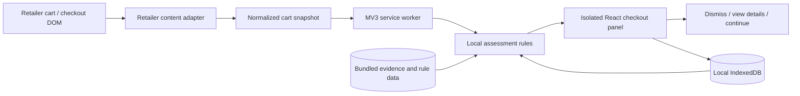

# Worth It — Technical Implementation Specification

**Status:** Proposed implementation baseline for the hackathon MVP  
**Product source:** [Product requirements](PRD.md)  
**Issue:** [#1 — Document Worth It technical implementation plan](https://github.com/girwandhakal/WorthIt/issues/1)

This document turns the current PRD into a buildable plan. It recommends a narrow, local-first Chrome extension that reads a supported checkout page, explains evidence-backed purchase concerns, and leaves every cart decision with the shopper.

## 1. Decisions at a glance

| Area | Recommended decision |
|---|---|
| Product | Worth It, an informational checkout assistant |
| Browser | Google Chrome, Manifest V3 |
| First retailer | Walmart US checkout/cart flow for the hackathon; Amazon is the next adapter |
| Language | TypeScript with strict checking |
| Extension tooling | WXT with Vite build pipeline |
| UI | React, TypeScript, CSS, and inline SVG/CSS animation |
| Local history | IndexedDB, wrapped with the small `idb` library |
| Cross-context messages | Typed browser runtime messages; validate all received payloads |
| Assessment | Deterministic, explainable rules and explicit evidence; no remote AI service in the MVP |
| Remote backend | None for the first demo |
| Personal finance | No account connection, balance, budget, or cash-flow data |
| Investment illustration | One optional aggregate-cart projection, using 10% assumed yearly return, annual compounding, 40 years, before inflation |
| Cart control | Read-only. Never add, remove, replace, or purchase an item |
| Animation | Short, skippable animated recap with captions and equivalent text |
| Release | Load unpacked for demo; prepare Chrome Web Store listing only after owner provides listing assets and policy details |

The PRD calls the product “AI-powered,” but its approved experience also requires evidence-backed, explainable statements. This baseline uses explicit rules and sources rather than a model that may invent claims. Before implementation, the owner should decide whether “AI-powered” means data-driven automated assessment (which these rules provide) or generative/model-based output. A model would add data sharing, cost, safety evaluation, and privacy decisions; it is not assumed here.

## 2. MVP boundary

The first usable slice should prove one complete journey:

1. The shopper opens a supported retailer cart or checkout page.
2. Worth It recognizes visible line items, quantities, and prices when available.
3. The extension assesses every recognized line item internally.
4. A compact panel summarizes only meaningful, supported observations and says when data is missing.
5. The panel may show store-brand savings, a recent similar purchase, or a qualifying nutrition note with its source.
6. It totals supported potential savings for the current cart and may show one optional projection at the end.
7. The shopper dismisses the panel, reviews evidence, or continues. They make all cart changes themselves.

Start with one retailer and a small set of product categories that can be demonstrated reliably. The PRD names Amazon and Walmart; this specification recommends Walmart US first because the grocery examples depend on grocery data. Confirm this retailer order before coding. Add Amazon through a separate adapter after the first full flow works.

Do not make computer vision, receipt OCR, account linking, cloud synchronization, a universal product catalog, or a hosted LLM part of the first release. A retailer page’s accessible text and structured DOM are the primary data source. If product data cannot be read safely, show “Couldn’t assess this item” rather than guessing.

## 3. Architecture and data flow



### Responsibilities

- **Retailer content adapter:** Reads only the supported retailer page, using stable accessible labels and narrowly scoped selectors. Converts the retailer-specific markup to a common cart shape. It observes page changes and debounces updates. It does not click retailer controls or alter cart state.
- **Service worker:** Coordinates extension messages and access to extension APIs. It is short-lived in Manifest V3, so it must not keep essential state only in memory.
- **Assessment module:** Applies testable rules to normalized cart items, local user preferences, purchase records, and bundled evidence. Each finding carries its reason, source, confidence, and calculation inputs.
- **Checkout panel:** Renders the findings and animated recap inside an isolated Shadow DOM root to reduce style collisions. All buttons are user-initiated and act only on Worth It’s interface.
- **Local data layer:** Stores settings, explicitly provided history, and user feedback locally. It offers export and delete operations from settings.
- **Bundled reference data:** Contains versioned health/evidence notes and conservative thresholds. Updates arrive only through a reviewed extension release; the extension does not execute remote code.

### Normalized cart item

Use a versioned TypeScript type with fields equivalent to:

- stable local item key;
- merchant identifier and product URL;
- title, brand, and category when detected;
- unit price, quantity, line price, currency, and price source;
- package size and unit price when available;
- ingredients/nutrition fields only when actually present on the page;
- observation time and extraction confidence.

Keep raw page text only in memory for extraction. Do not persist full page HTML, unrelated page content, checkout credentials, payment details, or browsing history.

### Assessment result

Each finding should include:

- rule identifier and rule-set version;
- item identifier;
- finding type (value, repeat purchase, health evidence, incomplete data, or no concern);
- short plain-language explanation;
- supporting values and source URL;
- confidence/data quality;
- optional suggested action;
- current-cart potential reduction, if calculable.

The UI copy is rendered from validated fields and reviewed templates. Never let a product title or page text become executable markup. Escape all retailer-provided strings.

## 4. Technology choices

### TypeScript, React, WXT

Use **TypeScript** for shared models and retailer adapters, with strict mode enabled. This catches mismatches between page extraction, assessment, storage, and UI before runtime.

Use **WXT** to generate the MV3 extension structure and support content-script entrypoints and development reload. Use **React** for the small settings and checkout-panel interfaces. Keep the UI as one compact surface rather than building a large dashboard before the checkout path works.

Use CSS transitions and inline SVG for the short animated summary. Do not add a video-generation service or a 3D engine for the MVP: the user needs an animated visual explanation, captions, and a readable summary; lightweight locally bundled animation is faster, accessible, and works offline. Respect reduced-motion settings and provide pause, replay, skip, and text alternatives.

### Storage

Use **IndexedDB** for purchase history and any growing record set; wrap it with `idb` to keep transactions readable. Use `chrome.storage.local` for small extension preferences such as enabled retailers, whether the investment illustration is on, and reduced-motion preference. Do not put history in `storage.sync` or sync it to a server.

Use schema versioning and an explicit migration path. Provide a “Delete all Worth It data” action. Export should be an explicit user action and produce a local JSON file; importing must validate schema and size before storing.

### No backend for the MVP

A backend is unnecessary for the first demo because page extraction, rules, sources, and history can run locally. This avoids API-key management and reduces privacy and uptime risks. No analytics SDK should be added unless the owner later approves a specific data inventory, consent flow, retention period, and privacy policy.

## 5. Repository layout

```text
WorthIt/
├── README.md
├── AGENTS.md
├── package.json
├── package-lock.json
├── wxt.config.ts
├── tsconfig.json
├── .gitignore
├── .env.example                 # Empty placeholders only if a later approved service needs configuration
├── docs/
│   ├── PRD.md
│   ├── TECH_SPEC.md
│   └── IMPLEMENTATION_PLAN.md
├── public/
│   ├── icon/                    # Extension sizes required for browser surfaces
│   └── sources/                 # Optional bundled evidence metadata, no executable code
├── entrypoints/
│   ├── background.ts            # MV3 service worker
│   ├── popup/
│   │   ├── index.html
│   │   ├── main.tsx
│   │   └── App.tsx
│   ├── options/
│   │   ├── index.html
│   │   └── main.tsx
│   └── walmart.content.tsx      # Walmart-only adapter and isolated checkout panel
├── src/
│   ├── domain/
│   │   ├── cart.ts
│   │   ├── product.ts
│   │   ├── finding.ts
│   │   └── history.ts
│   ├── adapters/
│   │   ├── retailer-adapter.ts
│   │   └── walmart/
│   │       ├── selectors.ts
│   │       ├── extract-cart.ts
│   │       └── observe-cart.ts
│   ├── assessment/
│   │   ├── assess-cart.ts
│   │   ├── rules/
│   │   │   ├── store-brand.ts
│   │   │   ├── repeat-purchase.ts
│   │   │   ├── nutrition.ts
│   │   │   └── investment.ts
│   │   └── evidence/
│   │       └── sources.ts
│   ├── storage/
│   │   ├── database.ts
│   │   ├── migrations.ts
│   │   └── repositories.ts
│   ├── messaging/
│   │   ├── messages.ts
│   │   └── validate-message.ts
│   ├── ui/
│   │   ├── checkout/
│   │   ├── animation/
│   │   └── shared/
│   └── shared/
│       ├── currency.ts
│       ├── calculations.ts
│       └── validation.ts
├── tests/
│   ├── fixtures/                # Sanitized, synthetic retailer DOM snapshots
│   ├── unit/
│   ├── integration/
│   └── e2e/
└── .github/
    └── workflows/
        └── ci.yml
```

Keep retailer-specific selectors out of rules and UI. A second retailer should add a new adapter and tests without changing the normalized assessment model.

## 6. Permissions, privacy, and security

Start with the smallest permissions that can support the selected checkout flow:

- `storage` for extension preferences;
- host access for the single supported retailer only, requested explicitly in the manifest;
- no tabs, history, cookies, webRequest, downloads, or broad all-sites access unless an implemented feature proves it is necessary.

Add another retailer’s host permission only when its adapter is ready. Explain in onboarding that Worth It reads cart product names, displayed prices, and relevant label details on supported retailer pages. Request purchase-history permission through a clear opt-in before recording future purchases. Users can inspect and delete their records.

Security requirements:

- Run all executable code from the packaged extension; no remotely hosted scripts, dynamic code evaluation, or inline event handlers.
- Validate every message crossing from content script to service worker.
- Treat retailer DOM as untrusted input.
- Render plain text, not unsanitized HTML.
- Keep sensitive storage restricted to trusted extension contexts where supported.
- Do not store payment details, login credentials, full page snapshots, or personal financial data.
- Keep the extension’s Content Security Policy restrictive.
- Make data collection, retention, export, and deletion match the Chrome Web Store disclosure and privacy policy before public release.

## 7. Assessment rules and calculation behavior

Keep decision rules deterministic, versioned, and explainable. “No concern” is a valid result and should not generate a warning. If evidence is insufficient, return uncertainty rather than a speculative claim.

- **Store brand:** Prefer an available store-brand suggestion as requested by the PRD. State the real per-unit and basket price difference. Claim “similar ingredients” only when retrieved labels support it. If the store brand is not cheaper, do not claim savings. Expose a material package, ingredient, or dietary mismatch.
- **Past grocery savings:** Use recorded quantities and either recorded historical prices or clearly labeled present-day price differences applied to historical quantities. Keep this hypothetical estimate separate from current-cart savings.
- **Repeat purchases:** Match normalized names/brands and cautiously compare category/purpose. A prior receipt proves purchase, not current ownership or use. Consumables can be routine restocking. Ask one brief question when the context would change the advice.
- **Health note:** Trigger only for a narrow, reviewed category/threshold and reliable item evidence. Use a credible source, describe population-level evidence carefully, and offer a short optional suggestion. Do not diagnose, claim one serving causes a disease, or give warnings for routine items. If nutrition data is missing, do not infer it from a title alone.
- **Cart summary:** Separate (1) lower-priced alternative savings and (2) the amount the user might avoid by removing a flagged item. Label both as potential, not realized, savings. Do not count the same item twice.
- **Investment illustration:** Only once at the end and only from aggregate current-cart potential savings. With principal (P), annual rate (r=0.10), yearly compounding, and (n=40), calculate (FV=P(1+r)^n). For $5, this is about $226.30 before inflation, fees, taxes, and uncertainty. State the assumed rate and term. This is an illustration, not a forecast or promise. Do not show item-level projections or use personal finances.

Prices and savings must use decimal-safe currency arithmetic (integer minor units such as cents), not floating point for money totals.

## 8. User interface behavior

At checkout, present a short visual sequence:

1. “Worth It reviewed your cart” with the number of items assessed.
2. Only items with a meaningful finding, each with item name, plain reason, actual evidence, and certainty level.
3. Store-brand suggestions with actual unit/cart price difference where available.
4. A repeat-purchase note that acknowledges uncertainty and asks a single useful question only if needed.
5. Qualifying health note with a concise source and practical phrasing.
6. Total potential current-cart reduction, clearly distinct from estimated historical savings.
7. Optional aggregate investment illustration at the end.
8. Controls to pause, replay, read captions/details, dismiss, or continue.

Never say “bad choice,” shame the shopper, or imply that an item is forbidden. “Consider skipping or reducing this item” can be offered for a qualifying concern; the shopper remains in charge. The recap must not block the retailer’s checkout. If animation is unavailable, reduced, or skipped, show the same information in a readable static panel. Keyboard navigation and screen-reader labels are required.

## 9. Local development and package scripts

Use Node.js LTS supported by the current WXT release, npm, and a committed lockfile. Pin dependency ranges intentionally and use reproducible installs in CI. Do not include API secrets in source control.

Expected scripts:

- `dev`: launch WXT with the selected Chrome target and local extension reload;
- `build`: produce the unpacked MV3 build;
- `zip`: package a release artifact;
- `typecheck`: run TypeScript without emitting files;
- `lint`: run ESLint on source;
- `test`: run Vitest unit/integration checks;
- `test:e2e`: run Playwright against bundled Chromium with a persistent extension context.

Exact WXT command flags should be taken from the installed version’s generated project and verified against that version’s docs, rather than copied from an older guide.

## 10. Test and quality plan

Do not begin with live retailer automation. Build confidence in layers:

1. **Unit tests:** currency rounding, aggregate savings, compound-growth math, item normalization, duplicate matching, nutrition threshold logic, and evidence/source rendering.
2. **Adapter tests:** sanitized HTML fixtures for cart rows, quantity changes, discounts, missing prices, multi-quantity lines, and page rerenders.
3. **Assessment tests:** each rule’s positive, negative, uncertain, and boundary cases; ensure missing data never becomes a health or savings claim.
4. **UI tests:** captions, keyboard controls, reduced motion, dismiss/continue, and no cart-edit actions.
5. **End-to-end:** load the unpacked extension in Chromium with a persistent context and local test fixture pages that mimic the supported retailer DOM.
6. **Manual retailer smoke check:** use a developer’s test cart, check page changes and selectors, and verify no interactions modify the cart. Retailer HTML may change; handle extraction failure visibly.

CI should install from the lockfile and run lint, typecheck, unit/integration tests, and production build. Keep screenshots and fixture data synthetic or scrubbed of account details. The user has asked for a spec, not implementation; checks begin when the code exists.

## 11. Build sequence

Repository guidance requires issue-linked work units. Create or confirm one GitHub issue for each stage, then implement in order:

1. **Foundation:** WXT + TypeScript skeleton, MV3 manifest, icons, build/lint/typecheck, CI.
2. **Retailer adapter:** Walmart cart extraction, normalization, fixture tests, extraction uncertainty UI.
3. **Read-only checkout surface:** isolated React panel, dynamic updates, accessible controls, no retailer-page mutation.
4. **Local history:** IndexedDB schema, import/manual entry, opt-in recording, review/delete/export.
5. **Assessment core:** store-brand prices, repeat detection, evidence templates, narrow nutrition triggers, savings aggregation.
6. **Animated recap:** short timeline and visuals, captions, reduced motion, pause/replay/skip.
7. **Integration and demo:** synthetic end-to-end scenario, manual retailer check, package and demo walkthrough.
8. **Second retailer:** Amazon adapter only after first retailer is reliable and scope is confirmed.

Do not parallelize issues unless their acceptance criteria are independent. Each PR should link its issue, state evidence/checks run, and document remaining limitations.

## 12. Packaging and release

For the hackathon demo, build a production extension ZIP or unpacked folder and install it through Chrome’s extension developer mode. Document the exact demo page and test account setup without committing credentials.

For Chrome Web Store release, the owner will need to provide or approve:

- listing name, description, screenshots, promotional graphics, and support contact;
- public privacy policy URL describing exact local and remote data flows;
- accurate single-purpose and data-use disclosures;
- final requested host permissions and justification;
- developer account and any applicable publishing fee/account requirements.

Submit only after the extension’s behavior, permission prompts, listing claims, and privacy disclosures agree. Chrome Web Store policy is subject to change; recheck official submission rules at release time.

## 13. Owner inputs needed before coding

The plan can proceed with defaults except where these choices alter user-visible behavior or data handling:

1. Confirm Walmart US is the first demo retailer, with Amazon second.
2. Resolve “AI-powered”: approve transparent local rule-based assessment for MVP, or explicitly require a model and accept a separate privacy/backend decision.
3. Confirm whether future-purchase recording is opt-in and whether the initial demo uses synthetic history, manually entered records, or a user-provided receipt.
4. Approve the specific health triggers, numeric thresholds, source wording, and reviewed claims. Do not ship a health rule based only on an example such as “candy” or “chips.”
5. Confirm whether aggregate investment illustration is enabled by default or is an opt-in setting.
6. Provide a Chrome test profile or confirm a synthetic fixture-only demo; do not share passwords or payment details.
7. For public store release, supply the listing/support/privacy materials listed above.

No API key, bank connection, retailer login, or personal financial data is needed for the recommended local-only MVP.

## 14. Risks and mitigations

| Risk | Mitigation |
|---|---|
| Retailer markup changes | Isolate selectors in adapters; fixture tests; fail visibly and safely |
| Product false match | Require conservative match confidence; show evidence; ask one question |
| Unsupported savings claim | Compute only from observed prices/quantity; use integer cents; disclose estimate basis |
| Health overclaim | Narrow reviewed triggers, authoritative sources, qualified wording, no inference from title |
| Broad extension access | One retailer permission at a time; explain and request only required host access |
| Animation obscures details | Captions, text equivalent, reduced motion, pause/skip, accessible focus order |
| PRD’s AI wording conflicts with local rules | Get owner decision before coding; never imply a model is used if it is not |
| Hackathon time pressure | One retailer, a few evidence-backed scenarios, synthetic fixtures |

## 15. Plain-English summary

Worth It should be a small Chrome add-on that notices what is in a supported shopping cart and gives the shopper a short, evidence-based pause before checkout. It can point out a cheaper store brand, a recent similar purchase, or a well-supported nutrition concern. It totals what could be saved and can show one optional example of how that total might grow if invested. It never edits the cart, never sees bank information, and keeps purchase history on the shopper’s device.

For the quickest credible demo, build the Walmart checkout flow first, use TypeScript/React/WXT, store history locally, and make every suggestion traceable to observed data or a cited source. The two choices that need your call before implementation are whether Walmart is first and what “AI-powered” means for this first release.

## 16. Primary documentation

These links were checked while preparing the plan. Recheck version-specific details when implementation begins.

- [Chrome Extensions: Manifest V3 overview](https://developer.chrome.com/docs/extensions/develop/migrate/what-is-mv3)
- [Chrome Extensions: service worker lifecycle](https://developer.chrome.com/docs/extensions/develop/concepts/service-workers/lifecycle)
- [Chrome Extensions: content scripts](https://developer.chrome.com/docs/extensions/develop/concepts/content-scripts)
- [Chrome Extensions: declare permissions](https://developer.chrome.com/docs/extensions/develop/concepts/declare-permissions)
- [Chrome Extensions: storage API](https://developer.chrome.com/docs/extensions/reference/api/storage)
- [Chrome Extensions: Content Security Policy](https://developer.chrome.com/docs/extensions/reference/manifest/content-security-policy)
- [Chrome Web Store: user data FAQ](https://developer.chrome.com/docs/webstore/program-policies/user-data-faq)
- [Chrome Web Store: program policies](https://developer.chrome.com/docs/webstore/program-policies/policies)
- [Chrome Web Store: publish an item](https://developer.chrome.com/docs/webstore/publish)
- [WXT: entrypoints](https://wxt.dev/guide/essentials/entrypoints)
- [WXT: content scripts](https://wxt.dev/guide/essentials/content-scripts)
- [React: thinking in React](https://react.dev/learn/thinking-in-react)
- [TypeScript: handbook introduction](https://www.typescriptlang.org/docs/handbook/intro.html)
- [Vitest: guide](https://vitest.dev/guide/)
- [Playwright: Chrome extensions](https://playwright.dev/docs/chrome-extensions)
- [CDC: added sugars and health](https://www.cdc.gov/nutrition/php/data-research/added-sugars.html)
- [WHO: non-sugar sweeteners guideline](https://www.who.int/publications/i/item/9789240073616)
